<div align="center">

<picture>
  <source media="(prefers-color-scheme: dark)" srcset="docs/images/duck-dark.png">
  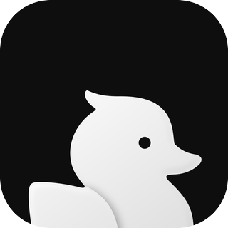
</picture>

<br>

<picture>
  <source media="(prefers-color-scheme: dark)" srcset="docs/images/wordmark-dark.svg">
  
</picture>

<br>

**An open VPN client for Android and Android TV, built on the mihomo core.**<br>
One button, honest status, nothing extra on the screen.

**English** · [Русский](docs/README.ru.md) · [简体中文](docs/README.zh-CN.md) · [فارسی](docs/README.fa.md)

[](https://github.com/duckerapp/ducker/releases)
[](LICENSE)
[](#install)
[](https://t.me/ducker_news)

[Install](#install) · [Screenshots](#screenshots) · [Features](#features) · [Android TV](#android-tv) · [For providers](#for-providers) · [Roadmap](#roadmap) · [FAQ](docs/FAQ.md) · [Community](#community)


Android 8+ · Bring your own subscription · [Download APKs](https://github.com/duckerapp/ducker/releases) · [GitLab downloads](https://gitlab.com/duckerx/ducker/-/packages) · [Website](https://duckerapp.github.io/ducker/)

<br>

<picture>
  <source media="(prefers-color-scheme: dark)" srcset="docs/images/en/hero-dark.png">
  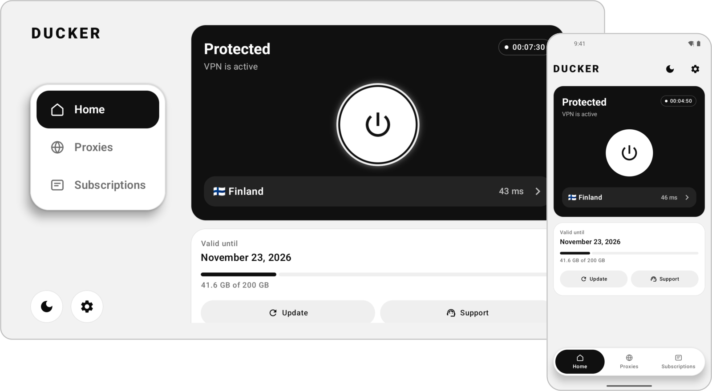
</picture>

</div>

## What it is

ducker connects your phone or TV to a VPN through the [mihomo](https://github.com/MetaCubeX/mihomo)
core. You add a subscription from your provider, press one button and, if you want, pick a server.

ducker started from [Clash Meta for Android](https://github.com/MetaCubeX/ClashMetaForAndroid).
It has its own Compose interface, subscription handling and app-update flow, while retaining
the VPN service and build foundations from CMFA. The VPN protocols come from mihomo.

## Screenshots

<p align="center">
  <a href="docs/images/en/phone-home.png"></a>
  <a href="docs/images/en/phone-groups.png">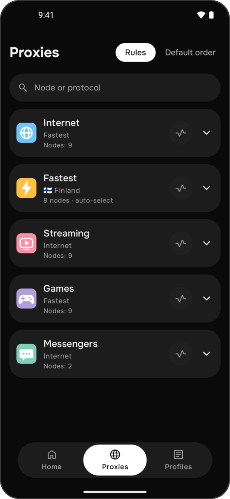</a>
  <a href="docs/images/en/phone-subscriptions.png">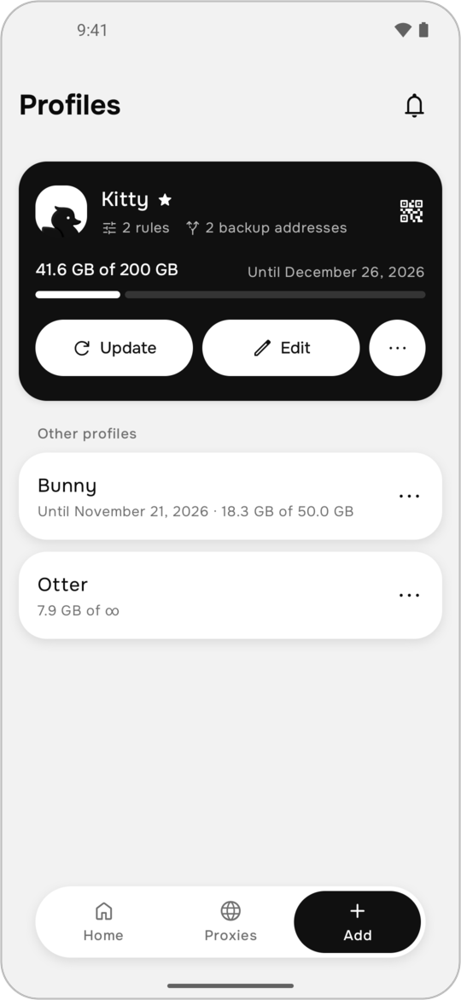</a>
</p>
<p align="center">
  <a href="docs/images/en/phone-proxies.png">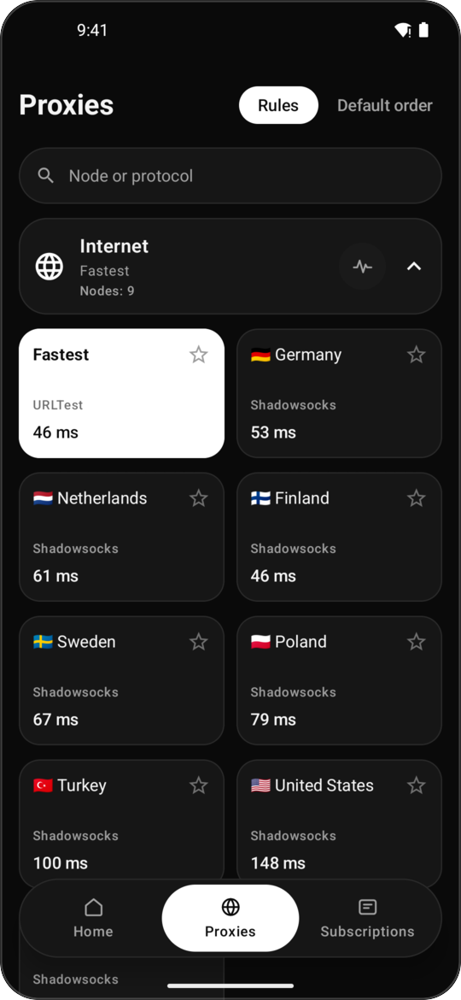</a>
  <a href="docs/images/en/phone-features.png">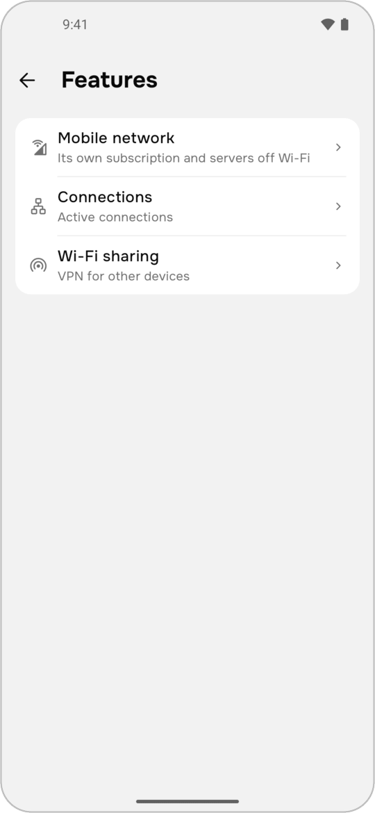</a>
  <a href="docs/images/en/phone-settings.png">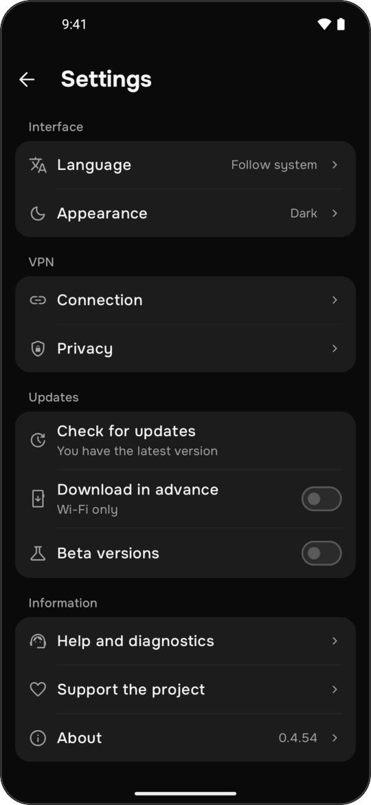</a>
</p>

<p align="center"><sub>Home · Groups · Profiles · Nodes · Features · Settings. The subscriptions and servers on the screenshots are made up.</sub></p>

<p align="center">
  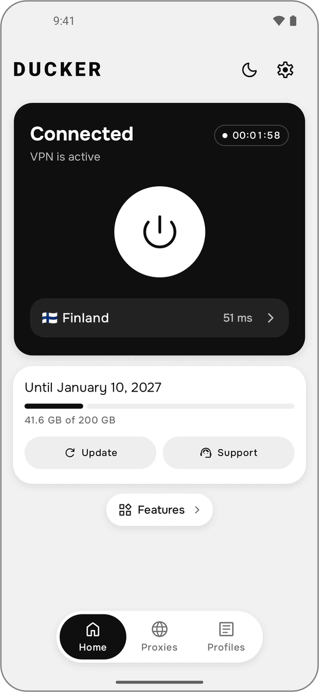
</p>

<p align="center"><sub>Switching between light and dark runs as a wave across the screen.</sub></p>

## Features

**Every day**

- **One screen for one job.** Home shows the power button, the current node with its delay, when
  the subscription ends and how much traffic is left. Everything else is a swipe away.
- **Honest status.** Right after the tunnel comes up ducker checks that traffic really goes
  through the node. If it doesn't, a card says so and offers to switch to the fastest node.
- **Errors in plain words.** When the VPN stops or a subscription fails to update, you see why and
  what to do, not an error code — including when the phone itself closed ducker in the background.
- **Subscriptions your way.** A link, a QR code or a file. Full mihomo configs work as they are;
  plain lists of `vless://`, `vmess://`, `ss://`, `trojan://` and similar links are placed into a
  built-in profile with routing for Russia: blocked sites go through the node, Russian ones go
  directly. Encrypted subscriptions open with the key from your provider.
- **Nodes.** Groups from your config with their icons, delay check, favorites, search, sorting by
  delay, and a node test that shows loss, minimum, average and maximum delay.
- **Updates itself.** A new version is one tap from Home; or let it install by itself at night.
  See [Updates](#updates).
- **Light and dark.** A black-and-white look in both themes; switching runs as a wave across the
  screen.

**Features** — a page under the subscription card on Home:

- **Mobile network.** A subscription and servers of its own for when the phone leaves Wi-Fi; back
  on Wi-Fi everything is as usual.
- **Connections.** Which apps connect where, live: the app, the site, the rule, the node, the speed.
- **Wi-Fi sharing.** The VPN's internet for a laptop or another phone, through a proxy on your
  network.

New features will keep arriving here in future versions.

**When you need more**

- **Apps.** Choose which apps go through the VPN and which bypass it.
- **My rules.** Send a website, an app, an address, a category or a whole country through the VPN,
  past it, or block it — without touching YAML.
- **Config editor.** Edit the profile on the device; the core checks it before it is applied. The
  profile is used as is: ducker never rewrites config keys silently.
- **Quick access.** Home screen widgets, a Quick Settings tile, launcher shortcuts, and optional
  [control from Tasker and similar apps](#control-from-other-apps).
- **Stays up.** Autostart after a reboot or an app update, and step-by-step help with the battery
  savers of Xiaomi, Samsung, Huawei, OPPO, vivo and Tecno phones that like to kill VPN apps.
- **Privacy extras.** Hide ducker from recent apps, disguise its icon as a calculator, or put the
  subscription link, its QR code and the config editor behind your fingerprint or PIN.
- **Provider news.** Announcements from your provider on Home and, for the last ten days, under
  the bell on Profiles.
- **Languages.** English, Russian, Chinese (Simplified), Persian, Arabic, Spanish, French,
  Indonesian, Portuguese (Brazil), Turkish and Vietnamese; Persian and Arabic are laid out right to
  left.

**Under the hood**

- **mihomo v1.19.34**, built from source with current uTLS fingerprints.
- **Community patches for the core:** an Xray-compatible mux (mux.cool with UDP and XUDP), REALITY
  in step with Xray (ML-KEM, ML-DSA-65) with a fallback for older servers, and a provider that
  skips a broken node instead of failing completely. Authors and sources are listed in
  [docs/CREDITS.md](docs/CREDITS.md).
- **Built-in [zashboard](https://github.com/Zephyruso/zashboard)** for diagnostics. It is bundled
  with the app and served locally by the core; nothing is downloaded at run time.
- **Measured on a budget phone.** On a Redmi Note 9S (2020, Android 12) the app cold-starts in
  about 0.4 s with the VPN running, and the VPN keeps working when Android unloads the interface.

**Configuration per subscription.** In **Profiles → ⋯ → Configuration**, keep **From the subscription**
for your provider's routing, or choose **ducker · Russia** to use its servers with ducker's
rules: Russian sites and apps go direct, other traffic through the VPN. Switching replaces
manual config edits. Encrypted subscriptions cannot use this template mode. A failed switch
keeps the previous working configuration; read the error and retry or choose the source.
[Configuration help](docs/FAQ.md#configuration-templates).

## Android TV

**From an iPhone or any phone without ducker:** scan the TV's QR with the ordinary camera,
open the page in the browser, paste your subscription link and press **Send**. No app is
needed on the sending device. Use your own home Wi-Fi and keep the QR open on the TV.
A computer can also open the link read from the QR. [Step-by-step guide](https://duckerapp.github.io/ducker/users/tv/#browser-transfer).

The same APK runs on Android TV and Google TV.

- **Made for the remote.** A dock on the left, a glowing frame around the focused element, and
  the screens work with the D-pad — down to the config editor and the log.
- **No typing a link with the remote.** The TV shows a QR code; scan it in ducker on your phone
  (Profiles → **Add** → Scan QR) and the subscription is sent to the TV over your home network.
  The link travels encrypted (AES-256-GCM) with a one-time key that exists only inside that QR
  code, and the TV listens only while the code is on the screen.
- **Checked on real TVs.** Reports from other TV models are welcome.

<p align="center">
  <a href="docs/images/en/tv-proxies.png">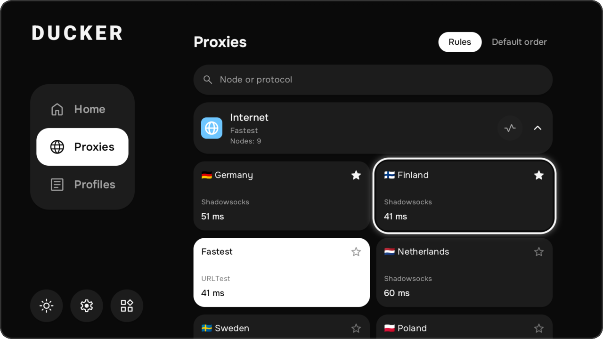</a>
  <a href="docs/images/en/tv-add.png">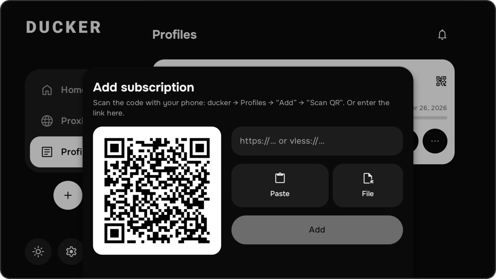</a>
</p>

## Install

1. Download the APK from [Releases](https://github.com/duckerapp/ducker/releases):
   - `arm64-v8a` — almost any phone made after 2017;
   - `armeabi-v7a` — older phones and many TVs; take it if the first one does not install.
2. Open the file. Android will ask to allow installation from this source — that is normal for
   apps from outside Google Play.
3. Add a subscription: **Profiles → Add →** paste the link from your provider, scan its QR code
   or pick a file. A link like `ducker://install-config?url=…` opens the same dialog straight from
   a chat or an email.
4. Press the power button on **Home** and allow Android's VPN request.

Android 8 or newer. Something does not work? [Questions and answers](docs/FAQ.md): how to add a
subscription, what to do if the VPN turns itself off or there is no internet, how to send a log.

### Updates

You install ducker by hand once; after that it updates itself.

- **It checks by itself** twice a day and when you open it. A new version shows up on Home and in
  a notification, with what's new; one tap downloads and installs it, and the VPN comes back by
  itself.
- **Update automatically** (Settings): new versions download over Wi-Fi and install while the
  screen is off, usually at night. Off until you say yes. Android 12 and newer; on Android 8–11
  Android asks for a confirmation each time.
- **Beta versions** (Settings): early access to test releases. A beta that goes well
  is then given to everyone as the very same file.
- **Where from.** The list of versions comes from GitHub, or from the
  [GitLab mirror](https://gitlab.com/duckerx/ducker) or jsDelivr when GitHub does not answer. Before
  installing, ducker checks the file's checksum and that it is signed with the same key as the
  installed app: a file from anyone else is not installed.

Background checks are approximate: Android can defer them. Play Protect or device policy may ask for installation confirmation even on Android 12+. Turning beta off does not downgrade an installed beta; stable promotion uses the same APK.

### Checking the file

- Each release comes with `SHA256SUMS`, the checksums of its APK files.
- Each release's notes link a [VirusTotal](https://www.virustotal.com) report for every APK: dozens
  of antivirus engines have looked at that exact file. You can upload your copy there yourself and
  compare.
- The app is built from this repository; the build also downloads the zashboard panel's release (checked by its
  SHA-256) and the country and site databases of MetaCubeX/meta-rules-dat. See [Build](#build) to do it yourself.

A VirusTotal report describes scan results for that file at the reported time; it is not a guarantee of safety.

### Google's developer verification

As of November 2026, ducker is not registered with Google's developer verification.
Google's initial enforcement covers participating stores on phones and tablets in selected
countries; direct APK downloads are not covered by that initial phase. Wider rollout is
planned from 2027. Requirements depend on country, device and distribution channel.
If Android asks for apps from unverified developers, follow the [FAQ](docs/FAQ.md#android-asks-to-allow-apps-from-unverified-developers).
Installing over `adb` is unaffected. [Google's current guidance](https://developer.android.com/developer-verification/guides/faq).

## For providers

ducker works with any regular mihomo subscription. It asks for one with the User-Agent
`mihomo/<core version> ducker/<app version> (android)`, so panels that give mihomo clients a
config give it to ducker too:

| Panel | ducker gets the mihomo config | Name, traffic, term | Announcement | Device limit | ducker's own headers |
|---|---|---|---|---|---|
| Remnawave | by default | yes | yes | yes | custom response headers |
| PasarGuard | by default | yes | yes | yes | custom response headers |
| Marzban | by default | yes | — | — | — |
| Marzneshin | add a rule `^mihomo` → `clash-meta` above the last one, or give users the `…/clash-meta` link | yes | — | — | — |
| 3x-ui | turn on the Clash subscription and its auto-detect, or give users the `/mihomo/<subid>` link | yes | yes | yes | — |
| Hiddify | give users the `…/clashmeta/` link | yes | — | — | — |

<sub>Checked against the panels' code in November 2026: Remnawave 3.4.8, PasarGuard 5.6.0, Marzban 0.8.4, Hiddify 14.2.0. Hiddify shows an unlimited plan as a date far ahead.</sub>

Where the panel gives a plain list of links instead, ducker still connects: it places the nodes
into its built-in profile.

On top of that, a provider can make the app look like its own with response headers of the
subscription request. In [Remnawave](https://github.com/remnawave/panel) they are set in the
subscription response settings (`customResponseHeaders`); the panel code does not need changes.

<p align="center">
  <picture>
    <source media="(prefers-color-scheme: dark)" srcset="docs/images/en/brand-dark.png">
    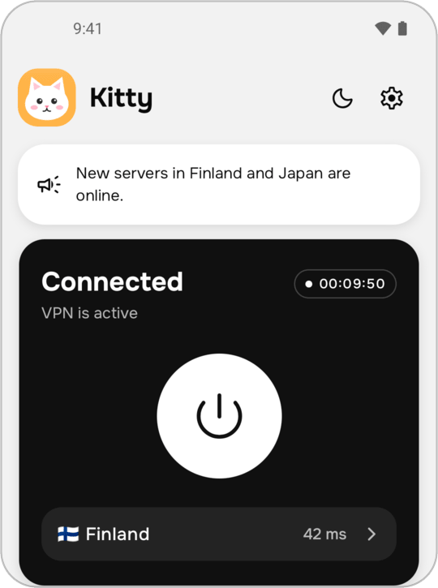
  </picture>
</p>

Provider reference: [headers](https://duckerapp.github.io/ducker/providers/headers/), [mirrors and encrypted subscriptions](https://duckerapp.github.io/ducker/providers/start/).

## Privacy and security

- **No analytics or reports to the developer.** No analytics, no ads, no crash reports sent to the developer. The
  project has no server of its own.
- **What goes to the network:** the subscription request to your provider, images the
  subscription refers to, the check for a new ducker version, and your traffic through the
  provider's servers. The full list is in the [privacy policy](PRIVACY_POLICY.md).
- **The core API** listens only on `127.0.0.1` and is protected by a random secret created at
  install time.
- **Logs stay on the device** until you export them yourself. Node addresses, keys and the device
  ID are removed first.
- **Only system certificates are trusted.** A certificate installed on the phone by hand cannot
  replace the provider's images or update answers.
- **Control from other apps is off** until you turn it on.

Found a vulnerability? Please report it privately: [SECURITY.md](SECURITY.md).

## How the project is made

ducker is made by one person together with an AI agent; the owner decides what to build.
We check the app with automated tests, emulators and real devices. The source code is open:
you can inspect how the app works and build it yourself.

Encryption and protocols are not ours: they come from the mihomo core. The pinned core submodule records the exact upstream and community changes, including
Xray-compatible mux and REALITY patches.
They are public in the [duckerapp/mihomo](https://github.com/duckerapp/mihomo) fork, branch `ducker`;
two smaller forks, [duckerapp/utls](https://github.com/duckerapp/utls) and
[duckerapp/sing-mux](https://github.com/duckerapp/sing-mux), carry a few more fixes.

## Control from other apps

For Tasker, shortcuts and similar tools. Turn on **Settings → Privacy → Control from other apps** first: it
is off by default, also after updating an existing installation. The permission applies to every
app that is able to send these commands. ducker's own widgets, tile and shortcuts work without it.

| Action | Intent |
|---|---|
| turn on | `am start -a app.ducker.android.action.START_CLASH` |
| turn off | `am start -a app.ducker.android.action.STOP_CLASH` |
| toggle | `am start -a app.ducker.android.action.TOGGLE_CLASH` |
| add a subscription | `ducker://install-config?url=<link>` |

## Roadmap

- **A desktop client** for Windows, Linux and macOS.
- **"Only through VPN":** chosen apps get no internet at all while the VPN is off.

No dates yet. An iOS version is not planned for now.

What has already been done, version by version, is in the [changelog](CHANGELOG.md).

## Build

Release tooling and the beta/stable workflow: [Releasing](docs/RELEASING.md).

You need JDK 21, the Android SDK (platform 37, NDK 29.0.14206865), git, curl and patch; the build
downloads its own Go.

```
git clone --recurse-submodules https://github.com/duckerapp/ducker.git
cd ducker
./gradlew :app:assembleMetaRelease
```

It will not build without `--recurse-submodules`: the core is a submodule. The result is signed
with the debug key; your own key is set in `signing.properties` in the repository root
(`keystore.path`, `keystore.password`, `key.alias`, `key.password`). `./scripts/smoke.sh` checks
the build on a connected phone.

Details are in [CONTRIBUTING.md](CONTRIBUTING.md); where things live in the code — in the
[code map](docs/ARCHITECTURE.md).

## Credits

- [MetaCubeX/mihomo](https://github.com/MetaCubeX/mihomo) — the core;
- [MetaCubeX/ClashMetaForAndroid](https://github.com/MetaCubeX/ClashMetaForAndroid) — the base of the VPN
  service and the build that ducker started from;
- [Zephyruso/zashboard](https://github.com/Zephyruso/zashboard) — the built-in web panel;
- the authors of the community core patches and of the ideas we borrowed — all named in
  [docs/CREDITS.md](docs/CREDITS.md).

## Community

- [Telegram channel](https://t.me/ducker_news) — releases and news;
- [Telegram chat](https://t.me/ducker_chat) — questions and discussion;
- [Issues](https://github.com/duckerapp/ducker/issues) — bugs and ideas;
- [duckermihomo@proton.me](mailto:duckermihomo@proton.me) — email, if Telegram and GitHub do not suit you;
- [CONTRIBUTING.md](CONTRIBUTING.md) — how to report a bug, build the app and send a change.

The project is run by one person, so help matters: bug reports, testing on your phone or TV,
and translations — especially from native speakers of the languages above.

To support the project with money: [CryptoBot](https://t.me/send?start=IVviDBljozrs) in Telegram, any coin, or a wallet — the addresses are
on the [website](https://duckerapp.github.io/ducker/support/donate/) and in the app under **Settings → Support the project**.

## License

[GPL-3.0](LICENSE), the same as the parent project.
