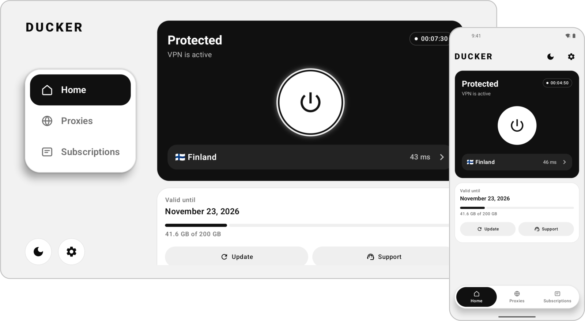
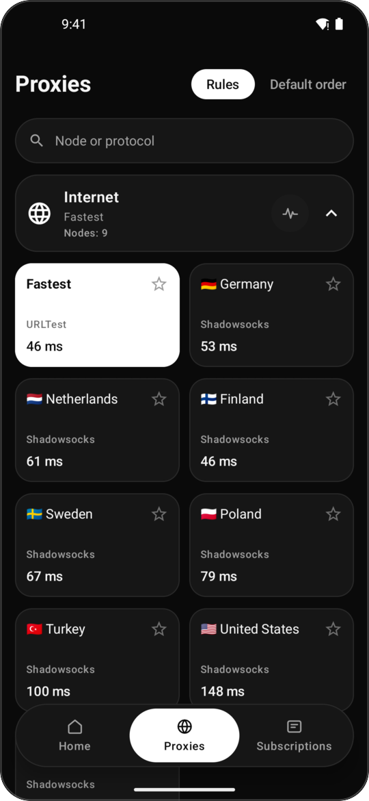
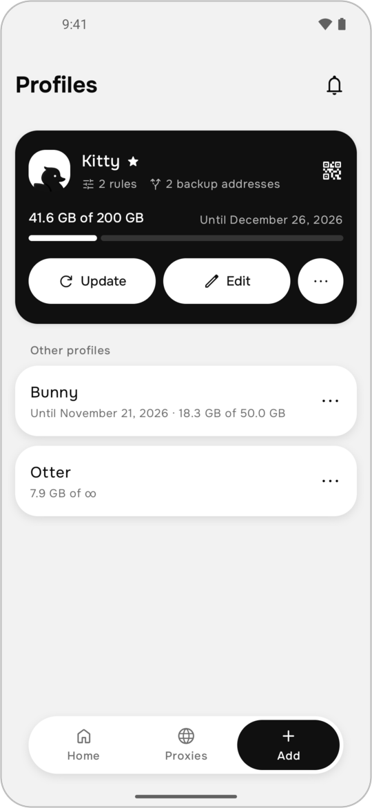
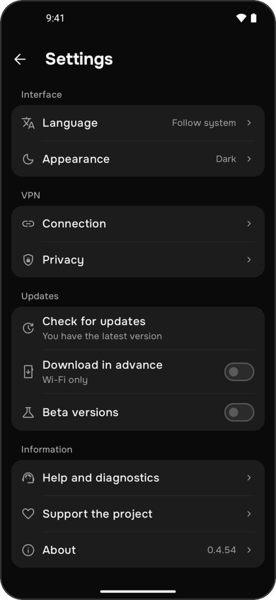
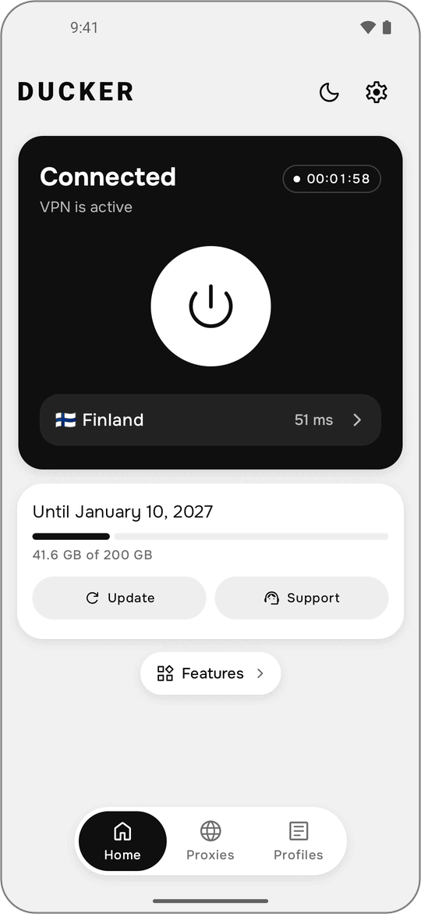
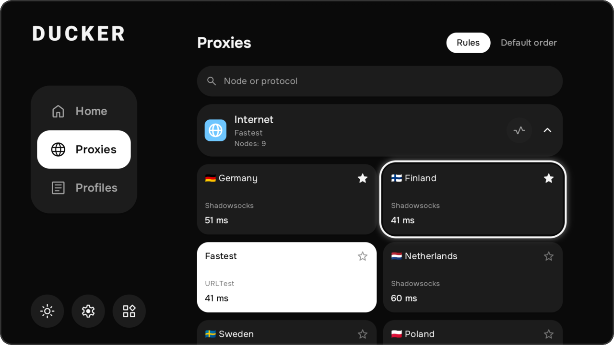
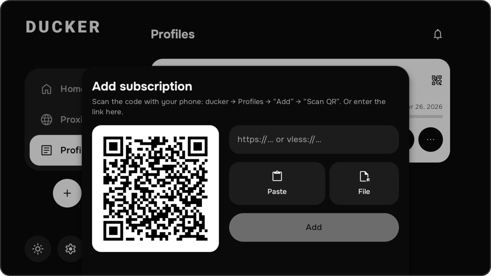
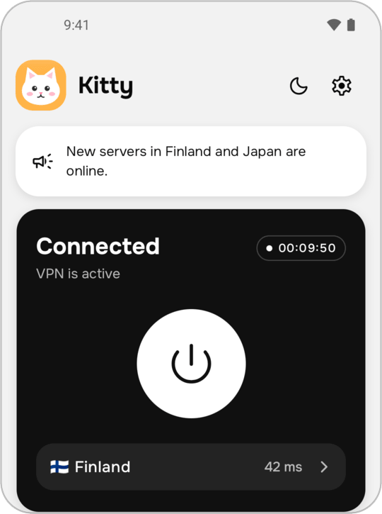

<div align="center">

<picture>
  <source media="(prefers-color-scheme: dark)" srcset="images/duck-dark.png">
  
</picture>

<br>

<picture>
  <source media="(prefers-color-scheme: dark)" srcset="images/wordmark-dark.svg">
  
</picture>

<br>

**کلاینت متن‌باز VPN برای Android و Android TV، بر پایهٔ هستهٔ mihomo**<br>
یک دکمه، وضعیت واقعی، و هیچ چیز اضافه‌ای روی صفحه.

[English](../README.md) · [Русский](README.ru.md) · [简体中文](README.zh-CN.md) · **فارسی**

[](https://github.com/duckerapp/ducker/releases)
[](../LICENSE)
[](#install)
[](https://t.me/ducker_mihomo)

[نصب](#install) · [تصاویر](#screenshots) · [امکانات](#features) · [Android TV](#android-tv) · [برای ارائه‌دهندگان](#providers) · [پرسش و پاسخ](FAQ.md) · [انجمن](#community)

<br>

<picture>
  <source media="(prefers-color-scheme: dark)" srcset="images/en/hero-dark.png">
  
</picture>

</div>

<div dir="rtl">

> این ترجمه را دستیار هوش مصنوعی انجام داده است و رابط برنامه فعلاً فقط انگلیسی و روسی است.
> اگر فارسی‌زبان هستید و ایرادی می‌بینید، لطفاً در
> [Issues](https://github.com/duckerapp/ducker/issues) بنویسید.

## ducker چیست

ducker گوشی یا تلویزیون شما را از طریق هستهٔ [mihomo](https://github.com/MetaCubeX/mihomo) به VPN
وصل می‌کند. اشتراکی را که از ارائه‌دهنده گرفته‌اید اضافه می‌کنید، یک دکمه را می‌زنید و اگر خواستید
سرور را انتخاب می‌کنید.

این برنامه فورکی از [Clash Meta for Android](https://github.com/MetaCubeX/ClashMetaForAndroid) است:
سرویس VPN و اتصال به هسته از آنجا آمده و رابط کاربری از نو با Jetpack Compose نوشته شده است.
رایگان، بدون تبلیغ، بدون آمارگیری، با مجوز GPL-3.0.

<a id="screenshots"></a>

## تصاویر

<p align="center">
  <a href="images/en/phone-home.png"></a>
  <a href="images/en/phone-proxies.png"></a>
  <a href="images/en/phone-subscriptions.png"></a>
  <a href="images/en/phone-settings.png"></a>
</p>

<p align="center"><sub>Home · Proxies · Subscriptions · Settings — ارائه‌دهنده و سرورهای داخل تصاویر ساختگی‌اند.</sub></p>

<p align="center">
  
</p>

<p align="center"><sub>تغییر تم مثل موجی روی صفحه پخش می‌شود.</sub></p>

<a id="features"></a>

## امکانات

**برای استفادهٔ روزمره**

- **یک صفحه برای یک کار.** صفحهٔ اصلی دکمهٔ روشن و خاموش، نود فعلی و تأخیر آن، تاریخ پایان اشتراک و
  حجم باقی‌مانده را نشان می‌دهد. بقیهٔ چیزها با یک حرکت انگشت در دسترس است.
- **وضعیت واقعی.** بلافاصله پس از برقراری تونل، ducker بررسی می‌کند که ترافیک واقعاً از نود عبور
  می‌کند. اگر نه، کارتی همین را می‌گوید و پیشنهاد می‌کند به سریع‌ترین نود بروید.
- **خطاها به زبان ساده.** وقتی VPN متوقف می‌شود یا اشتراک به‌روز نمی‌شود، دلیل و راه‌حل را می‌بینید،
  نه یک کد خطا.
- **اشتراک به هر شکلی.** لینک، کد QR یا فایل. کانفیگ کامل mihomo همان‌طور که هست استفاده می‌شود؛
  فهرست سادهٔ لینک‌های `vless://`، `vmess://`، `ss://`، `trojan://` و مانند آن در یک پروفایل داخلی
  قرار می‌گیرد که مسیریابی آن برای روسیه تنظیم شده است: سایت‌های مسدودشده از نود می‌روند و
  سایت‌های روسی مستقیم.
- **نودها.** گروه‌های کانفیگ شما، سنجش تأخیر، علاقه‌مندی‌ها، جست‌وجو، مرتب‌سازی بر اساس تأخیر و
  آزمون نود که میزان ازدست‌رفتن بسته‌ها و کمترین، میانگین و بیشترین تأخیر را نشان می‌دهد.
- **روشن و تیره.** ظاهر سیاه‌وسفید در هر دو تم؛ تغییر تم مثل موجی روی صفحه پخش می‌شود.

**وقتی بیشتر لازم دارید**

- **برنامه‌ها.** انتخاب کنید کدام برنامه‌ها از VPN عبور کنند و کدام‌ها نه.
- **قانون‌های من.** یک سایت، برنامه، نشانی، دسته یا کل یک کشور را از VPN عبور دهید، از کنار آن
  بفرستید یا مسدود کنید — بدون دست‌زدن به YAML.
- **ویرایشگر کانفیگ.** پروفایل را روی خود دستگاه ویرایش کنید؛ هسته پیش از اعمال آن را بررسی می‌کند.
  پروفایل همان‌طور که هست استفاده می‌شود: ducker هیچ کلیدی از کانفیگ را بی‌خبر بازنویسی نمی‌کند.
- **دسترسی سریع.** ویجت‌های صفحهٔ خانه، کاشی تنظیمات سریع، میانبرها و در صورت تمایل
  [کنترل از Tasker و برنامه‌های مشابه](#control).
- **روشن می‌ماند.** شروع خودکار پس از راه‌اندازی دوبارهٔ گوشی یا به‌روزرسانی برنامه، و راهنمای
  گام‌به‌گام برای بهینه‌ساز باتری در گوشی‌های Xiaomi، Samsung، Huawei، OPPO، vivo و Tecno که
  برنامه‌های VPN را می‌بندند.
- **حریم خصوصی.** می‌توانید ducker را از فهرست برنامه‌های اخیر پنهان کنید یا آیکون آن را به شکل
  ماشین‌حساب درآورید.
- **زبان‌ها.** انگلیسی و روسی؛ چینی ساده‌شده و فارسی در برنامه است.

**زیر کاپوت**

- **mihomo v1.19.32** که از کد منبع و با اثرانگشت‌های به‌روز uTLS ساخته شده است.
- **وصله‌های جامعهٔ کاربری برای هسته:** مالتی‌پلکس سازگار با Xray (mux.cool با UDP و XUDP)، REALITY
  هماهنگ با Xray (ML-KEM و ML-DSA-65) با حالت جایگزین برای سرورهای قدیمی، و provider که نود خراب
  را نادیده می‌گیرد به‌جای اینکه کاملاً از کار بیفتد. نام نویسندگان و منابع در
  [CREDITS.md](CREDITS.md) آمده است.
- **پنل داخلی [zashboard](https://github.com/Zephyruso/zashboard)** برای عیب‌یابی. همراه برنامه است
  و هسته آن را روی خود دستگاه ارائه می‌کند؛ هنگام اجرا چیزی از شبکه دانلود نمی‌شود.
- **سنجیده‌شده روی گوشی ارزان.** روی Redmi Note 9S (سال ۲۰۲۰، Android 12) برنامه با VPN روشن در
  حدود ۰٫۴ ثانیه بالا می‌آید و وقتی Android رابط کاربری را از حافظه خارج می‌کند، VPN به کار ادامه
  می‌دهد.

<a id="android-tv"></a>

## Android TV

همان فایل APK روی Android TV و Google TV هم اجرا می‌شود.

- **ساخته‌شده برای کنترل تلویزیون.** نوار ناوبری در کنار صفحه، قابی درخشان دور عنصر انتخاب‌شده؛
  صفحه‌های اصلی — Home، Proxies و Profiles — با کلیدهای جهت‌دار کار می‌کنند.
- **بدون تایپ لینک با کنترل.** تلویزیون یک کد QR نشان می‌دهد؛ آن را در ducker روی گوشی اسکن کنید
  (Profiles ← **+** ← Scan QR) تا اشتراک از طریق شبکهٔ خانگی به تلویزیون فرستاده شود. لینک
  رمزگذاری‌شده (AES-256-GCM) و با کلید یک‌بارمصرفی منتقل می‌شود که فقط در همان کد QR وجود دارد، و
  تلویزیون فقط تا وقتی کد روی صفحه است به شبکه گوش می‌دهد.
- **هنوز در حال تکمیل.** پشتیبانی از تلویزیون تازه است. برخی صفحه‌هایی که از تنظیمات باز می‌شوند
  هنوز با کنترل راحت نیستند و تاکنون بیشتر در شبیه‌ساز آزمایش شده است — گزارش از تلویزیون‌های
  واقعی بسیار کمک می‌کند.

<p align="center">
  <a href="images/en/tv-proxies.png"></a>
  <a href="images/en/tv-add.png"></a>
</p>

<a id="install"></a>

## نصب

1. فایل APK را از [Releases](https://github.com/duckerapp/ducker/releases) دانلود کنید:
   - `arm64-v8a` — تقریباً هر گوشی ساخت ۲۰۱۷ به بعد؛
   - `armeabi-v7a` — گوشی‌های قدیمی‌تر و بسیاری از تلویزیون‌ها؛ اگر اولی نصب نشد این را بگیرید.
2. فایل را باز کنید. Android اجازهٔ نصب از این منبع را می‌خواهد — برای برنامه‌های خارج از
   Google Play طبیعی است.
3. اشتراک را اضافه کنید: **Subscriptions ← + ←** لینک ارائه‌دهنده را بچسبانید، کد QR آن را اسکن
   کنید یا فایل را انتخاب کنید. لینکی مانند `ducker://install-config?url=…` همان پنجره را مستقیم
   از چت یا ایمیل باز می‌کند.
4. در **Home** دکمهٔ روشن و خاموش را بزنید و درخواست VPN را در Android تأیید کنید.

Android 10 یا بالاتر لازم است. همراه هر نسخه فایل `SHA256SUMS` برای فایل‌های APK منتشر می‌شود.

مشکلی هست؟ [پرسش و پاسخ](FAQ.md): چگونه اشتراک اضافه کنیم، اگر VPN خودبه‌خود قطع شد یا اینترنت
نبود چه کنیم، چگونه لاگ بفرستیم. این صفحه به انگلیسی است.

<a id="providers"></a>

## برای ارائه‌دهندگان

ducker با هر اشتراک معمولی mihomo کار می‌کند. علاوه بر این، ارائه‌دهنده می‌تواند با هدرهای پاسخِ
درخواست اشتراک، برنامه را به شکل برند خودش درآورد. در
[Remnawave](https://github.com/remnawave/panel) این هدرها در تنظیمات پاسخ اشتراک
(`customResponseHeaders`) تعریف می‌شوند و نیازی به تغییر کد پنل نیست.

<p align="center">
  <picture>
    <source media="(prefers-color-scheme: dark)" srcset="images/en/brand-dark.png">
    
  </picture>
</p>

- **`ducker-brand-name: <text>`** — نام ارائه‌دهنده در بالای صفحهٔ اصلی به‌جای DUCKER. در اعلان و
  روی کاشی تنظیمات سریع هم نمایش داده می‌شود.
- **`ducker-brand-logo: <image>`** — لوگو در کنار نام در صفحهٔ اصلی و روی کارت اشتراک. یک لینک
  `https://…` یا خود تصویر به شکل `data:…;base64,…`؛ با قالب PNG، JPEG، WebP یا SVG. اگر بارگذاری
  نشود، آیکون ducker نمایش داده می‌شود.
- **`ducker-buy-url: <link>`** — دکمهٔ **Renew** روی کارت اشتراک، وقتی کمتر از سه روز یا کمتر از
  ۱۰٪ حجم باقی مانده یا مدت تمام شده باشد. همین لینک در اعلان پایان اشتراک هم به کار می‌رود. بدون
  این هدر از `profile-web-page-url` استفاده می‌شود.
- **`ducker-global: off`** — کلید Global/Rules را در صفحهٔ Proxies پنهان می‌کند؛ حالت همان می‌ماند
  که در کانفیگ تعیین شده است.
- **`ducker-local-proxy: off`** — تونل با پورت‌های محلی بستهٔ کانفیگ (`mixed-port`، `port`،
  `socks-port`، `redir-port`، `tproxy-port`) و بدون `listeners` بالا می‌آید تا برنامه‌های دیگر
  روی گوشی نتوانند پروکسی را روی `127.0.0.1` پیدا کنند. خود کانفیگ بازنویسی نمی‌شود. با هدر
  نمی‌توان پورتی را باز کرد.
- **`ducker-override-user: on | off`** — برای تنظیماتی که ارائه‌دهنده با هدر تعیین می‌کند کنار
  گذاشته شده است. برنامه آن را می‌خواند ولی فعلاً اثری ندارد.

قواعد کلی:

- بزرگی و کوچکی حروف در نام هدر مهم نیست.
- متنی که نویسهٔ غیر ASCII یا شکست خط دارد به شکل `base64:<…>` (UTF-8) فرستاده می‌شود؛ همان‌طور که
  Remnawave هدر `announce` را می‌فرستد.
- یک خط تیرهٔ تنها `-` یعنی «تعیین نشده»: پنل اجازهٔ ذخیرهٔ هدر خالی را نمی‌دهد و با خط تیره
  می‌توانید هدر خودتان را بردارید.
- هدرها فقط ظاهر و رفتارِ فهرست بالا را تغییر می‌دهند و به هیچ چیز امنیتی دسترسی ندارند: رمز API
  هسته، لاگ‌ها یا نشانی به‌روزرسانی برنامه.

ducker هدرهای رایج اشتراک را هم می‌شناسد: `profile-title`، `profile-update-interval`،
`profile-web-page-url`، `support-url`، `announce`، `subscription-userinfo`،
`subscription-refill-date`.

**محدودیت تعداد دستگاه.** ducker با هر درخواست اشتراک یک شناسهٔ ثابت دستگاه را در `x-hwid` و همراه
آن `x-device-os`، `x-ver-os` و `x-device-model` می‌فرستد تا پنل بتواند دستگاه‌ها را بشمارد. کاربر
این شناسه را در **Settings ← Privacy ← Device ID** می‌بیند و می‌تواند آن را خاموش کند. شناسه فقط روی HTTPS
فرستاده می‌شود.

**نصب با یک لمس.** `ducker://install-config?url=<subscription link>` پنجرهٔ افزودن اشتراک را با
لینکِ پرشده باز می‌کند؛ تا کاربر تأیید نکند چیزی دانلود نمی‌شود.

## حریم خصوصی و امنیت

- **هیچ چیزی جمع‌آوری نمی‌شود.** نه آمار، نه تبلیغ، نه گزارش خرابی برای توسعه‌دهنده. پروژه سروری
  از خودش ندارد.
- **آنچه به شبکه می‌رود:** درخواست اشتراک به ارائه‌دهندهٔ شما، تصاویری که اشتراک به آن‌ها اشاره
  می‌کند، و ترافیک شما از طریق سرورهای ارائه‌دهنده. فهرست کامل در
  [سیاست حریم خصوصی](../PRIVACY_POLICY.md) است.
- **API هسته** فقط روی `127.0.0.1` گوش می‌دهد و با رمزی تصادفی که هنگام نصب ساخته می‌شود محافظت
  می‌شود.
- **لاگ‌ها روی دستگاه می‌مانند** تا وقتی خودتان آن‌ها را خروجی بگیرید. پیش از آن نشانی نودها،
  کلیدها و شناسهٔ دستگاه حذف می‌شود.
- **فقط به گواهی‌های سیستم اعتماد می‌شود.** با گواهی‌ای که دستی روی گوشی نصب شده نمی‌توان تصاویر
  ارائه‌دهنده یا پاسخ به‌روزرسانی را جعل کرد.
- **کنترل از برنامه‌های دیگر خاموش است** تا وقتی خودتان روشنش کنید.

آسیب‌پذیری پیدا کرده‌اید؟ لطفاً خصوصی گزارش دهید: [SECURITY.md](../SECURITY.md).

## پروژه چگونه ساخته می‌شود

ducker را یک نفر همراه با یک دستیار هوش مصنوعی می‌سازد. کد را Claude، مدل هوش مصنوعی شرکت
Anthropic، می‌نویسد و اینکه چه چیزی ساخته شود را صاحب پروژه تعیین می‌کند. هر تغییر پیش از انتشار
ساخته و آزمایش می‌شود و روی دستگاه‌های واقعی بررسی می‌شود، و هر کسی می‌تواند ساخت را از همین مخزن
تکرار کند.

رمزنگاری و پروتکل‌ها کار ما نیست: از هستهٔ mihomo می‌آیند. تغییرات ما در هسته ۲۱ کامیت روی
v1.19.32 است که ۱۳ تای آن وصله‌های جامعهٔ کاربری برای مالتی‌پلکس سازگار با Xray و REALITY است.
این تغییرات در فورک [duckerapp/mihomo](https://github.com/duckerapp/mihomo)، شاخهٔ `ducker`، عمومی است؛ چهار کامیت دیگر در دو فورک کوچک‌تر،
[duckerapp/utls](https://github.com/duckerapp/utls) و [duckerapp/sing-mux](https://github.com/duckerapp/sing-mux)، قرار دارد.

<a id="control"></a>

## کنترل از برنامه‌های دیگر

برای Tasker، میانبرها و ابزارهای مشابه. ابتدا **Settings ← Privacy ← Control from other apps** را روشن کنید:
به‌طور پیش‌فرض خاموش است، حتی پس از به‌روزرسانی نصب قبلی. این اجازه برای همهٔ برنامه‌هایی که
بتوانند این فرمان‌ها را بفرستند اعمال می‌شود. ویجت‌ها، کاشی و میانبرهای خود ducker بدون آن کار
می‌کنند.

| کار | Intent |
|---|---|
| روشن‌کردن | `am start -a app.ducker.android.action.START_CLASH` |
| خاموش‌کردن | `am start -a app.ducker.android.action.STOP_CLASH` |
| تغییر وضعیت | `am start -a app.ducker.android.action.TOGGLE_CLASH` |
| افزودن اشتراک | `ducker://install-config?url=<link>` |

## برنامهٔ آینده

- Android TV: صفحه‌های باقی‌مانده برای کنترل تلویزیون و صفحهٔ شروع با کد QR.
- چینی ساده‌شده و فارسی، همراه با چیدمان راست‌به‌چپ.
- اعلان نسخهٔ جدید درون برنامه.
- کلاینت‌های Linux و Windows به‌صورت پروژه‌ای جداگانه در برنامه‌اند؛ هنوز زمانی برایشان تعیین
  نشده است.

آنچه تاکنون انجام شده، نسخه به نسخه، در [فهرست تغییرات](../CHANGELOG.md) آمده است (به انگلیسی).

## ساخت از کد منبع

به JDK 21، Android SDK (platform 37 و NDK 29.0.14206865)، git، curl و patch نیاز دارید؛ Go را خودِ فرایند ساخت دانلود می‌کند.

<div dir="ltr">

```
git clone --recurse-submodules https://github.com/duckerapp/ducker.git
cd ducker
./gradlew :app:assembleMetaRelease
```

</div>

بدون `--recurse-submodules` ساخته نمی‌شود: هسته یک زیرماژول است. خروجی با کلید دیباگ امضا می‌شود؛
کلید خودتان را در فایل `signing.properties` در ریشهٔ مخزن تعیین کنید (`keystore.path`،
`keystore.password`، `key.alias`، `key.password`). اسکریپت `./scripts/smoke.sh` ساخت را روی گوشی
متصل بررسی می‌کند.

جزئیات در [CONTRIBUTING.md](../CONTRIBUTING.md) است (به انگلیسی)؛ ساختار کد در
[نقشهٔ کد](ARCHITECTURE.md) آمده است (به انگلیسی).

## قدردانی

- [MetaCubeX/mihomo](https://github.com/MetaCubeX/mihomo) — هسته؛
- [MetaCubeX/ClashMetaForAndroid](https://github.com/MetaCubeX/ClashMetaForAndroid) — سرویس VPN،
  سیستم ساخت و هر آنچه زیر رابط کاربری است؛
- [Zephyruso/zashboard](https://github.com/Zephyruso/zashboard) — پنل وب داخلی؛
- نویسندگان وصله‌های هسته و ایده‌هایی که وام گرفته‌ایم — نام همه در [CREDITS.md](CREDITS.md) آمده
  است.

<a id="community"></a>

## انجمن

- [کانال Telegram](https://t.me/ducker_mihomo) — نسخه‌ها و خبرها؛
- [گروه Telegram](https://t.me/ducker_community) — پرسش و گفت‌وگو؛
- [Issues](https://github.com/duckerapp/ducker/issues) — خطاها و ایده‌ها؛
- [duckermihomo@proton.me](mailto:duckermihomo@proton.me) — ایمیل، اگر Telegram و GitHub برایتان مناسب نیست؛
- [CONTRIBUTING.md](../CONTRIBUTING.md) — چگونه خطا گزارش کنیم، برنامه را بسازیم و تغییر بفرستیم.

پروژه را یک نفر اداره می‌کند، پس هر کمکی مهم است: گزارش خطا، آزمایش روی گوشی یا تلویزیون خودتان،
و ترجمه — به‌ویژه از فارسی‌زبانان و چینی‌زبانان.

## مجوز

[GPL-3.0](../LICENSE)، همانند پروژهٔ مادر.

</div>
