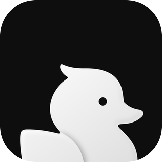
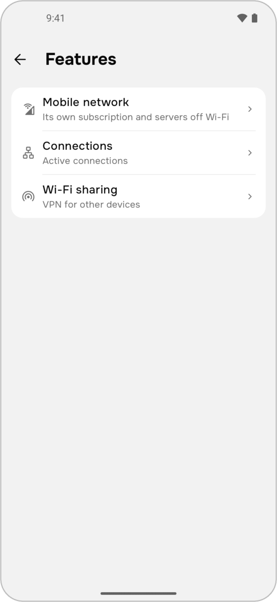

<div align="center">

<picture>
  <source media="(prefers-color-scheme: dark)" srcset="images/duck-dark.png">
  
</picture>

<br>

<picture>
  <source media="(prefers-color-scheme: dark)" srcset="images/wordmark-dark.svg">
  
</picture>

<br>

**کلاینت متن‌باز VPN برای Android و Android TV، بر پایهٔ هستهٔ mihomo**<br>
یک دکمه، وضعیت واقعی، و هیچ چیز اضافه‌ای روی صفحه.

[English](../README.md) · [Русский](README.ru.md) · [简体中文](README.zh-CN.md) · **فارسی**

[](https://github.com/duckerapp/ducker/releases)
[](../LICENSE)
[](#install)
[](https://t.me/ducker_mihomo)

[نصب](#install) · [تصاویر](#screenshots) · [امکانات](#features) · [Android TV](#android-tv) · [برای ارائه‌دهندگان](#providers) · [برنامهٔ آینده](#roadmap) · [پرسش و پاسخ](FAQ.md) · [انجمن](#community)


Android 8+ · به اشتراک خودتان نیاز دارید · [دانلود APK](https://github.com/duckerapp/ducker/releases) · [آینهٔ GitLab](https://gitlab.com/duckerx/ducker/-/packages) · [وب‌سایت انگلیسی](https://duckerapp.github.io/ducker/)

<br>

<picture>
  <source media="(prefers-color-scheme: dark)" srcset="images/en/hero-dark.png">
  
</picture>

</div>

<div dir="rtl">

> این صفحه و رابط فارسی برنامه را دستیار هوش مصنوعی ترجمه کرده است. اگر فارسی‌زبان هستید و ایرادی
> می‌بینید، لطفاً در [Issues](https://github.com/duckerapp/ducker/issues) بنویسید. تصاویر از رابط
> انگلیسی‌اند.

<a id="what"></a>

## ducker چیست

ducker یک کلاینت VPN برای Android بر پایهٔ mihomo است و به اشتراک ارائه‌دهنده نیاز دارد. پروژه از [Clash Meta for Android](https://github.com/MetaCubeX/ClashMetaForAndroid) آغاز شده و رابط Compose، مدیریت اشتراک و روند به‌روزرسانی خودش را دارد؛ پایهٔ سرویس VPN و ساخت از CMFA آمده است.

<a id="screenshots"></a>

## تصاویر

<p align="center">
  <a href="images/en/phone-home.png"></a>
  <a href="images/en/phone-groups.png"></a>
  <a href="images/en/phone-subscriptions.png"></a>
</p>
<p align="center">
  <a href="images/en/phone-proxies.png"></a>
  <a href="images/en/phone-features.png"></a>
  <a href="images/en/phone-settings.png"></a>
</p>

<p align="center"><sub>خانه · گروه‌ها · اشتراک‌ها · نودها · امکانات · تنظیمات — اشتراک‌ها و سرورهای داخل تصاویر ساختگی‌اند.</sub></p>

<p align="center">
  
</p>

<p align="center"><sub>تغییر تم مثل موجی روی صفحه پخش می‌شود.</sub></p>

<a id="features"></a>

## امکانات

**برای استفادهٔ روزمره**

- **یک صفحه برای یک کار.** صفحهٔ اصلی دکمهٔ روشن و خاموش، نود فعلی و تأخیر آن، تاریخ پایان اشتراک و
  حجم باقی‌مانده را نشان می‌دهد. بقیهٔ چیزها با یک حرکت انگشت در دسترس است.
- **وضعیت واقعی.** بلافاصله پس از برقراری تونل، ducker بررسی می‌کند که ترافیک واقعاً از نود عبور
  می‌کند. اگر نه، کارتی همین را می‌گوید و پیشنهاد می‌کند به سریع‌ترین نود بروید.
- **خطاها به زبان ساده.** وقتی VPN متوقف می‌شود یا اشتراک به‌روز نمی‌شود، دلیل و راه‌حل را می‌بینید،
  نه یک کد خطا — حتی وقتی خود گوشی ducker را در پس‌زمینه بسته است.
- **اشتراک به هر شکلی.** لینک، کد QR یا فایل. کانفیگ کامل mihomo همان‌طور که هست استفاده می‌شود؛
  فهرست سادهٔ لینک‌های `vless://`، `vmess://`، `ss://`، `trojan://` و مانند آن در یک پروفایل داخلی
  قرار می‌گیرد که مسیریابی آن برای روسیه تنظیم شده است: سایت‌های مسدودشده از نود می‌روند و
  سایت‌های روسی مستقیم. اشتراک رمزگذاری‌شده با کلیدی که ارائه‌دهنده می‌دهد باز می‌شود.
- **نودها.** گروه‌های کانفیگ شما با آیکون‌هایشان، سنجش تأخیر، علاقه‌مندی‌ها، جست‌وجو، مرتب‌سازی بر
  اساس تأخیر و آزمون نود که میزان ازدست‌رفتن بسته‌ها و کمترین، میانگین و بیشترین تأخیر را نشان
  می‌دهد.
- **خودش را به‌روز می‌کند.** نسخهٔ جدید با یک لمس از صفحهٔ اصلی نصب می‌شود، یا می‌توانید بگذارید
  شب‌ها خودش نصب شود. بخش [به‌روزرسانی](#updates) را ببینید.
- **روشن و تیره.** ظاهر سیاه‌وسفید در هر دو تم؛ تغییر تم مثل موجی روی صفحه پخش می‌شود.

**«امکانات»** — صفحه‌ای زیر کارت اشتراک در صفحهٔ اصلی:

- **شبکهٔ همراه.** اشتراک و سرورهای جداگانه برای وقتی که گوشی از Wi-Fi جدا می‌شود؛ با بازگشت به
  Wi-Fi همه چیز مثل قبل است.
- **اتصال‌ها.** اینکه کدام برنامه به کجا وصل می‌شود، به‌صورت زنده: برنامه، سایت، قانون، نود و سرعت.
- **اشتراک‌گذاری با Wi-Fi.** اینترنت VPN برای لپ‌تاپ یا گوشی دیگر، از طریق یک پروکسی در شبکهٔ شما.

قابلیت‌های تازه در نسخه‌های بعدی همین‌جا اضافه می‌شوند.

**وقتی بیشتر لازم دارید**

- **برنامه‌ها.** انتخاب کنید کدام برنامه‌ها از VPN عبور کنند و کدام‌ها نه.
- **قانون‌های من.** یک سایت، برنامه، نشانی، دسته یا کل یک کشور را از VPN عبور دهید، از کنار آن
  بفرستید یا مسدود کنید — بدون دست‌زدن به YAML.
- **ویرایشگر کانفیگ.** پروفایل را روی خود دستگاه ویرایش کنید؛ هسته پیش از اعمال آن را بررسی می‌کند.
  پروفایل همان‌طور که هست استفاده می‌شود: ducker هیچ کلیدی از کانفیگ را بی‌خبر بازنویسی نمی‌کند.
- **دسترسی سریع.** ویجت‌های صفحهٔ خانه، کاشی تنظیمات سریع، میانبرها و در صورت تمایل
  [کنترل از Tasker و برنامه‌های مشابه](#control).
- **روشن می‌ماند.** شروع خودکار پس از راه‌اندازی دوبارهٔ گوشی یا به‌روزرسانی برنامه، و راهنمای
  گام‌به‌گام برای بهینه‌ساز باتری در گوشی‌های Xiaomi، Samsung، Huawei، OPPO، vivo و Tecno که
  برنامه‌های VPN را می‌بندند.
- **حریم خصوصی.** می‌توانید ducker را از فهرست برنامه‌های اخیر پنهان کنید، آیکون آن را به شکل
  ماشین‌حساب درآورید، یا لینک اشتراک، کد QR آن و ویرایشگر کانفیگ را پشت اثر انگشت یا PIN قرار دهید.
- **خبرهای ارائه‌دهنده.** اطلاعیه‌های ارائه‌دهنده در صفحهٔ اصلی، و اطلاعیه‌های ده روز اخیر زیر
  آیکون زنگ در صفحهٔ اشتراک‌ها.
- **زبان‌ها.** انگلیسی، روسی، چینی ساده‌شده، فارسی، عربی، اسپانیایی، فرانسوی، اندونزیایی، پرتغالی
  (برزیل)، ترکی و ویتنامی؛ فارسی و عربی با چیدمان راست‌به‌چپ.

**زیر کاپوت**

- **mihomo v1.19.34** که از کد منبع و با اثرانگشت‌های به‌روز uTLS ساخته شده است.
- **وصله‌های جامعهٔ کاربری برای هسته:** مالتی‌پلکس سازگار با Xray (mux.cool با UDP و XUDP)، REALITY
  هماهنگ با Xray (ML-KEM و ML-DSA-65) با حالت جایگزین برای سرورهای قدیمی، و provider که نود خراب
  را نادیده می‌گیرد به‌جای اینکه کاملاً از کار بیفتد. نام نویسندگان و منابع در
  [CREDITS.md](CREDITS.md) آمده است.
- **پنل داخلی [zashboard](https://github.com/Zephyruso/zashboard)** برای عیب‌یابی. همراه برنامه است
  و هسته آن را روی خود دستگاه ارائه می‌کند؛ هنگام اجرا چیزی از شبکه دانلود نمی‌شود.
- **سنجیده‌شده روی گوشی ارزان.** روی Redmi Note 9S (سال ۲۰۲۰، Android 12) برنامه با VPN روشن در
  حدود ۰٫۴ ثانیه بالا می‌آید و وقتی Android رابط کاربری را از حافظه خارج می‌کند، VPN به کار ادامه
  می‌دهد.

**پیکربندی جداگانه برای هر اشتراک.** از منوی «⋯» اشتراک، بخش پیکربندی را باز کنید: تنظیمات ارائه‌دهنده را نگه دارید یا `ducker · Russia` را انتخاب کنید تا سرورها از اشتراک و قواعد از ducker بیایند. سایت‌ها و برنامه‌های روسی مستقیم و بقیه از VPN می‌گذرند. تغییر پیکربندی ویرایش‌های دستی را جایگزین می‌کند؛ اشتراک رمزگذاری‌شده از این حالت پشتیبانی نمی‌کند. اگر تغییر ناموفق باشد، پیکربندی سالم قبلی باقی می‌ماند. [توضیحات انگلیسی](FAQ.md#configuration-templates).

<a id="android-tv"></a>

## Android TV

همان فایل APK روی Android TV و Google TV هم اجرا می‌شود.

- **ساخته‌شده برای کنترل تلویزیون.** نوار ناوبری در کنار صفحه، قابی درخشان دور عنصر انتخاب‌شده، و
  صفحه‌ها با کلیدهای جهت‌دار کار می‌کنند — حتی ویرایشگر کانفیگ و لاگ.
- **بدون تایپ لینک با کنترل.** تلویزیون یک کد QR نشان می‌دهد؛ آن را در ducker روی گوشی اسکن کنید
  (اشتراک‌ها ← افزودن ← اسکن QR) تا اشتراک از طریق شبکهٔ خانگی به تلویزیون فرستاده شود. لینک
  رمزگذاری‌شده (AES-256-GCM) و با کلید یک‌بارمصرفی منتقل می‌شود که فقط در همان کد QR وجود دارد، و
  تلویزیون فقط تا وقتی کد روی صفحه است به شبکه گوش می‌دهد.
- **روی تلویزیون‌های واقعی بررسی شده است.** گزارش از مدل‌های دیگر تلویزیون بسیار کمک می‌کند.

<p align="center">
  <a href="images/en/tv-proxies.png"></a>
  <a href="images/en/tv-add.png"></a>
</p>

<a id="install"></a>

## نصب

1. فایل APK را از [Releases](https://github.com/duckerapp/ducker/releases) دانلود کنید:
   - `arm64-v8a` — تقریباً هر گوشی ساخت ۲۰۱۷ به بعد؛
   - `armeabi-v7a` — گوشی‌های قدیمی‌تر و بسیاری از تلویزیون‌ها؛ اگر اولی نصب نشد این را بگیرید.
2. فایل را باز کنید. Android اجازهٔ نصب از این منبع را می‌خواهد — برای برنامه‌های خارج از
   Google Play طبیعی است.
3. اشتراک را اضافه کنید: **اشتراک‌ها ← افزودن ←** لینک ارائه‌دهنده را بچسبانید، کد QR آن را اسکن
   کنید یا فایل را انتخاب کنید. لینکی مانند `ducker://install-config?url=…` همان پنجره را مستقیم
   از چت یا ایمیل باز می‌کند.
4. در **خانه** دکمهٔ روشن و خاموش را بزنید و درخواست VPN را در Android تأیید کنید.

Android 8 یا بالاتر لازم است. مشکلی هست؟ [پرسش و پاسخ](FAQ.md): چگونه اشتراک اضافه کنیم، اگر VPN
خودبه‌خود قطع شد یا اینترنت نبود چه کنیم، چگونه لاگ بفرستیم. این صفحه به انگلیسی است.

### به‌روزرسانی

ducker را یک بار دستی نصب می‌کنید؛ از آن به بعد خودش را به‌روز می‌کند.

- **خودش بررسی می‌کند**، روزی دو بار و هر بار که باز می‌شود. نسخهٔ جدید همراه با فهرست تغییرات در
  صفحهٔ اصلی و در اعلان نمایش داده می‌شود؛ با یک لمس دانلود و نصب می‌شود و VPN خودش دوباره وصل
  می‌شود.
- **«به‌روزرسانی خودکار»** (در تنظیمات): نسخه‌های جدید از طریق Wi-Fi دانلود و وقتی صفحه خاموش است
  نصب می‌شوند، معمولاً شب. تا وقتی موافقت نکنید خاموش است. Android 12 و بالاتر؛ در Android 8 تا 11
  سیستم هر بار تأیید می‌خواهد.
- **«نسخه‌های آزمایشی (Beta)»** (در تنظیمات): نسخه‌های جدید چند روز زودتر از بقیه. نسخهٔ
  آزمایشی‌ای که خوب کار کند، بعداً با همان فایل به دست همه می‌رسد.
- **از کجا.** فهرست نسخه‌ها از GitHub گرفته می‌شود، و اگر GitHub پاسخ ندهد از
  [آینهٔ GitLab](https://gitlab.com/duckerx/ducker) یا jsDelivr. ducker پیش از نصب، چک‌سام فایل را
  بررسی می‌کند و مطمئن می‌شود که با همان کلید برنامهٔ نصب‌شده امضا شده است: فایلِ کس دیگری نصب
  نمی‌شود.

Android ممکن است بررسی پس‌زمینه را عقب بیندازد؛ حتی در Android 12+، Play Protect یا سیاست دستگاه ممکن است تأیید نصب بخواهد. خاموش کردن beta نسخهٔ نصب‌شده را پایین نمی‌آورد؛ همان APK به نسخهٔ پایدار ارتقا می‌یابد.

### بررسی فایل

- همراه هر نسخه فایل `SHA256SUMS` با چک‌سام فایل‌های APK منتشر می‌شود.
- در توضیحات هر نسخه برای هر APK لینکی به گزارش [VirusTotal](https://www.virustotal.com) هست: ده‌ها
  آنتی‌ویروس همین فایل را بررسی کرده‌اند. می‌توانید نسخهٔ خودتان را هم آنجا بارگذاری و مقایسه کنید.
- برنامه از همین مخزن ساخته می‌شود؛ هنگام ساخت، نسخهٔ منتشرشدهٔ پنل zashboard (با بررسی SHA-256) و پایگاه‌های
  داده‌ٔ کشورها و سایت‌های MetaCubeX/meta-rules-dat هم دانلود می‌شوند؛ روش ساخت در بخش [ساخت از کد منبع](#build) آمده است.

گزارش VirusTotal نتیجهٔ اسکن همان فایل در زمان ذکرشده است و تضمین امنیت نیست.

### تأیید هویت توسعه‌دهنده در Google

تا نوامبر ۲۰۲۶، ducker در برنامهٔ تأیید توسعه‌دهندگان Google ثبت نشده است. مرحلهٔ نخست فقط فروشگاه‌های مشخصی را روی گوشی‌ها و تبلت‌ها در بعضی کشورها پوشش می‌دهد و فعلاً شامل دانلود مستقیم APK نمی‌شود. گسترش برنامه از ۲۰۲۷ در نظر گرفته شده است؛ شرایط به کشور، دستگاه و روش نصب بستگی دارد. اگر Android اجازهٔ نصب برنامه‌های توسعه‌دهندگان تأییدنشده را خواست، [پرسش و پاسخ انگلیسی](FAQ.md#android-asks-to-allow-apps-from-unverified-developers) را ببینید. نصب با `adb` تغییر نمی‌کند. [راهنمای رسمی Google](https://developer.android.com/developer-verification/guides/faq).

<a id="providers"></a>

## برای ارائه‌دهندگان

ducker با هر اشتراک معمولی mihomo کار می‌کند. اشتراک را با User-Agent
`mihomo/<core version> ducker/<app version> (android)` درخواست می‌کند، پس پنل‌هایی که به کلاینت‌های
mihomo کانفیگ می‌دهند، به ducker هم می‌دهند:

| پنل | ducker کانفیگ mihomo می‌گیرد | نام، حجم، مدت | اطلاعیه | سقف دستگاه | هدرهای ویژهٔ ducker |
|---|---|---|---|---|---|
| Remnawave | به‌طور پیش‌فرض | بله | بله | بله | هدرهای سفارشی پاسخ |
| PasarGuard | به‌طور پیش‌فرض | بله | بله | بله | هدرهای سفارشی پاسخ |
| Marzban | به‌طور پیش‌فرض | بله | — | — | — |
| Marzneshin | قانون `^mihomo` ← `clash-meta` را بالای قانون آخر اضافه کنید، یا لینک `…/clash-meta` را بدهید | بله | — | — | — |
| 3x-ui | اشتراک Clash و تشخیص خودکار آن را روشن کنید، یا لینک `/mihomo/<subid>` را بدهید | بله | بله | بله | — |
| Hiddify | لینک `…/clashmeta/` را بدهید | بله | — | — | — |

<sub>در نوامبر ۲۰۲۶ با کد پنل‌ها مقایسه شده است: Remnawave 3.4.8، PasarGuard 5.6.0، Marzban 0.8.4، Hiddify 14.2.0. Hiddify طرح نامحدود را با تاریخی بسیار دور نشان می‌دهد.</sub>

اگر پنل فقط فهرست سادهٔ لینک‌ها را بدهد، ducker باز هم وصل می‌شود: نودها را در پروفایل داخلی خود
قرار می‌دهد.

علاوه بر این، ارائه‌دهنده می‌تواند با هدرهای پاسخِ درخواست اشتراک، برنامه را به شکل برند خودش
درآورد. در [Remnawave](https://github.com/remnawave/panel) این هدرها در تنظیمات پاسخ اشتراک
(`customResponseHeaders`) تعریف می‌شوند و نیازی به تغییر کد پنل نیست.

<p align="center">
  <picture>
    <source media="(prefers-color-scheme: dark)" srcset="images/en/brand-dark.png">
    
  </picture>
</p>

راهنمای ارائه‌دهنده به انگلیسی: [هدرها](https://duckerapp.github.io/ducker/providers/headers/)، [آینه‌ها و اشتراک رمزگذاری‌شده](https://duckerapp.github.io/ducker/providers/start/).

<a id="privacy"></a>

## حریم خصوصی و امنیت

- **هیچ چیزی جمع‌آوری نمی‌شود.** نه آمار، نه تبلیغ، نه گزارش خرابی برای توسعه‌دهنده. پروژه سروری
  از خودش ندارد.
- **آنچه به شبکه می‌رود:** درخواست اشتراک به ارائه‌دهندهٔ شما، تصاویری که اشتراک به آن‌ها اشاره
  می‌کند، بررسی نسخهٔ جدید ducker، و ترافیک شما از طریق سرورهای ارائه‌دهنده. فهرست کامل در
  [سیاست حریم خصوصی](../PRIVACY_POLICY.md) است.
- **API هسته** فقط روی `127.0.0.1` گوش می‌دهد و با رمزی تصادفی که هنگام نصب ساخته می‌شود محافظت
  می‌شود.
- **لاگ‌ها روی دستگاه می‌مانند** تا وقتی خودتان آن‌ها را خروجی بگیرید. پیش از آن نشانی نودها،
  کلیدها و شناسهٔ دستگاه حذف می‌شود.
- **فقط به گواهی‌های سیستم اعتماد می‌شود.** با گواهی‌ای که دستی روی گوشی نصب شده نمی‌توان تصاویر
  ارائه‌دهنده یا پاسخ به‌روزرسانی را جعل کرد.
- **کنترل از برنامه‌های دیگر خاموش است** تا وقتی خودتان روشنش کنید.

آسیب‌پذیری پیدا کرده‌اید؟ لطفاً خصوصی گزارش دهید: [SECURITY.md](../SECURITY.md).

<a id="development"></a>

## پروژه چگونه ساخته می‌شود

ducker را یک نگهدارنده همراه با دستیار AI توسعه می‌دهد. بررسی‌ها شامل آزمون خودکار، ساخت و بعضی سناریوها در شبیه‌ساز و دستگاه واقعی است؛ پوشش به تغییر و دستگاه بستگی دارد و ممیزی مستقل امنیتی محسوب نمی‌شود. ساخت از منبع ممکن است، اما بازتولید بایت‌به‌بایت APK انتشار تأیید نشده است. رمزنگاری و پروتکل‌ها از mihomo می‌آیند و نسخهٔ دقیق در زیرماژول ثابت است. تغییرات در فورک‌های [mihomo](https://github.com/duckerapp/mihomo)، [uTLS](https://github.com/duckerapp/utls) و [sing-mux](https://github.com/duckerapp/sing-mux) قرار دارند.

<a id="control"></a>

## کنترل از برنامه‌های دیگر

برای Tasker، میانبرها و ابزارهای مشابه. ابتدا **تنظیمات ← حریم خصوصی ← کنترل از برنامه‌های دیگر** را
روشن کنید: به‌طور پیش‌فرض خاموش است، حتی پس از به‌روزرسانی نصب قبلی. این اجازه برای همهٔ برنامه‌هایی
که بتوانند این فرمان‌ها را بفرستند اعمال می‌شود. ویجت‌ها، کاشی و میانبرهای خود ducker بدون آن کار
می‌کنند.

| کار | Intent |
|---|---|
| روشن‌کردن | `am start -a app.ducker.android.action.START_CLASH` |
| خاموش‌کردن | `am start -a app.ducker.android.action.STOP_CLASH` |
| تغییر وضعیت | `am start -a app.ducker.android.action.TOGGLE_CLASH` |
| افزودن اشتراک | `ducker://install-config?url=<link>` |

<a id="roadmap"></a>

## برنامهٔ آینده

- **کلاینت رایانه** برای Windows، Linux و macOS.
- **ظاهر شیشه‌ای:** پنل‌های نیمه‌شفاف به‌عنوان سبک دیگری برای رابط.
- **«فقط از طریق VPN»:** برنامه‌های انتخاب‌شده تا وقتی VPN خاموش است اصلاً اینترنت ندارند.

هنوز زمانی تعیین نشده است. فعلاً نسخهٔ iOS در برنامه نیست.

آنچه تاکنون انجام شده، نسخه به نسخه، در [فهرست تغییرات](../CHANGELOG.md) آمده است (به انگلیسی).

<a id="build"></a>

## ساخت از کد منبع

به JDK 21، Android SDK (platform 37 و NDK 29.0.14206865)، git، curl و patch نیاز دارید؛ Go را خودِ فرایند ساخت دانلود می‌کند.

<div dir="ltr">

```
git clone --recurse-submodules https://github.com/duckerapp/ducker.git
cd ducker
./gradlew :app:assembleMetaRelease
```

</div>

بدون `--recurse-submodules` ساخته نمی‌شود: هسته یک زیرماژول است. خروجی با کلید دیباگ امضا می‌شود؛
کلید خودتان را در فایل `signing.properties` در ریشهٔ مخزن تعیین کنید (`keystore.path`،
`keystore.password`، `key.alias`، `key.password`). اسکریپت `./scripts/smoke.sh` ساخت را روی گوشی
متصل بررسی می‌کند.

جزئیات در [CONTRIBUTING.md](../CONTRIBUTING.md) است (به انگلیسی)؛ ساختار کد در
[نقشهٔ کد](ARCHITECTURE.md) آمده است (به انگلیسی).

<a id="credits"></a>

## قدردانی

- [MetaCubeX/mihomo](https://github.com/MetaCubeX/mihomo) — هسته؛
- [MetaCubeX/ClashMetaForAndroid](https://github.com/MetaCubeX/ClashMetaForAndroid) — پایهٔ سرویس VPN
  و سیستم ساخت که ducker از آن شروع شد؛
- [Zephyruso/zashboard](https://github.com/Zephyruso/zashboard) — پنل وب داخلی؛
- نویسندگان وصله‌های هسته و ایده‌هایی که وام گرفته‌ایم — نام همه در [CREDITS.md](CREDITS.md) آمده
  است.

<a id="community"></a>

## انجمن

- [کانال Telegram](https://t.me/ducker_mihomo) — نسخه‌ها و خبرها؛
- [گروه Telegram](https://t.me/ducker_community) — پرسش و گفت‌وگو؛
- [Issues](https://github.com/duckerapp/ducker/issues) — خطاها و ایده‌ها؛
- [duckermihomo@proton.me](mailto:duckermihomo@proton.me) — ایمیل، اگر Telegram و GitHub برایتان مناسب نیست؛
- [CONTRIBUTING.md](../CONTRIBUTING.md) — چگونه خطا گزارش کنیم، برنامه را بسازیم و تغییر بفرستیم.

پروژه را یک نفر اداره می‌کند، پس هر کمکی مهم است: گزارش خطا، آزمایش روی گوشی یا تلویزیون خودتان،
و ترجمه — به‌ویژه از گویشوران زبان‌های بالا.

<a id="license"></a>

## مجوز

[GPL-3.0](../LICENSE)، همانند پروژهٔ مادر.

</div>
