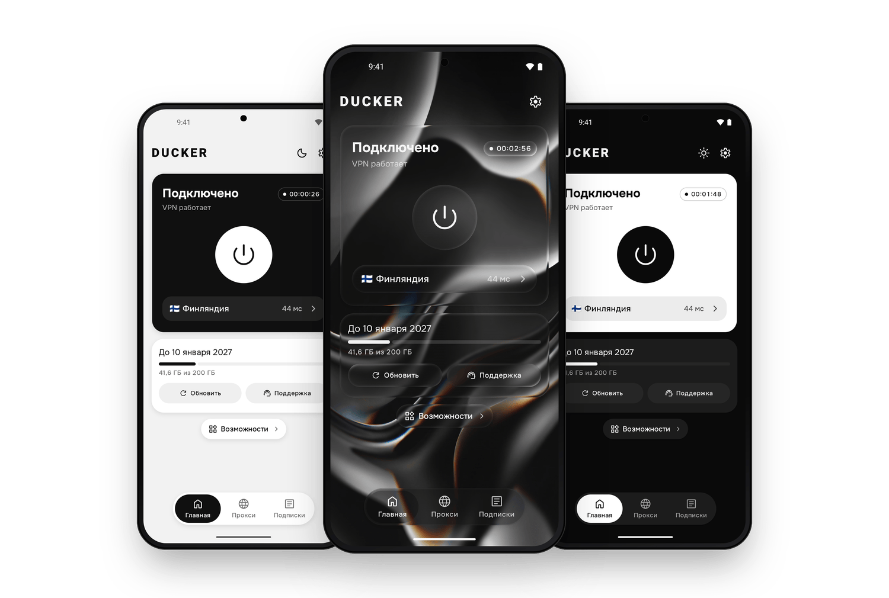
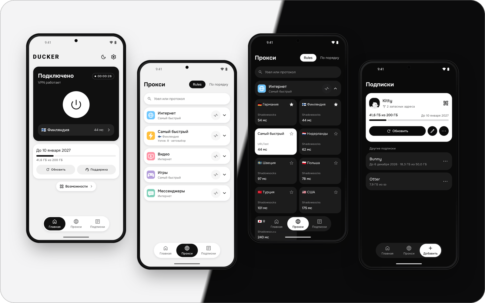
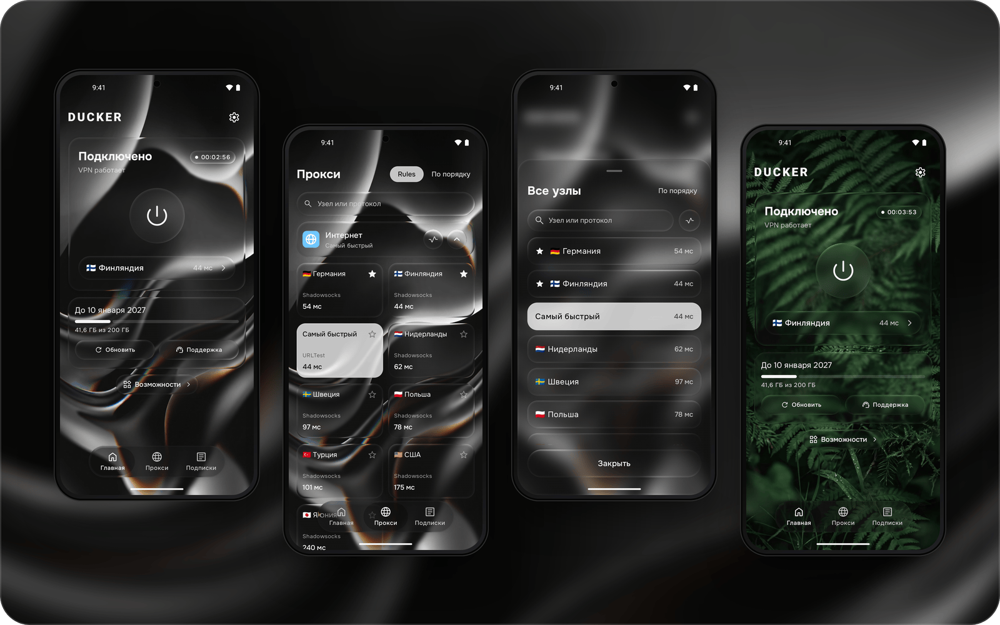
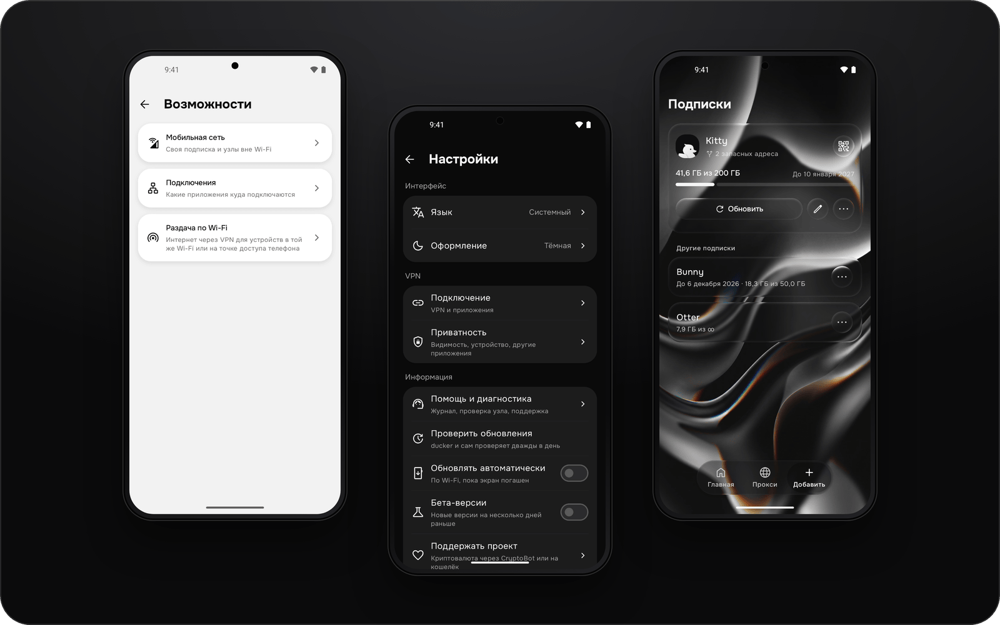
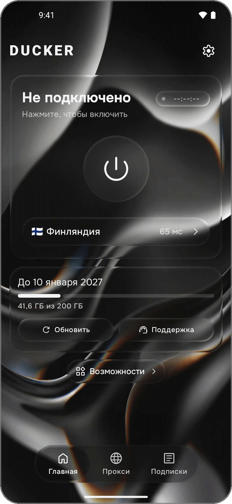
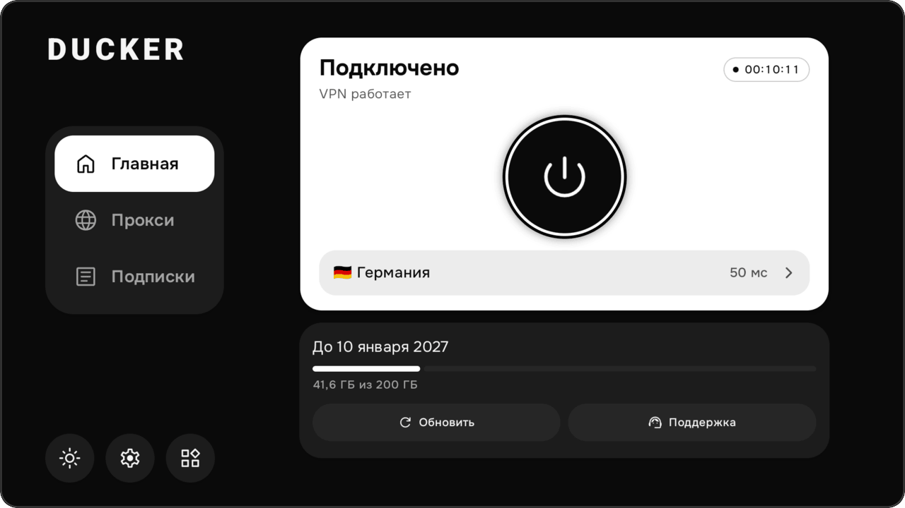
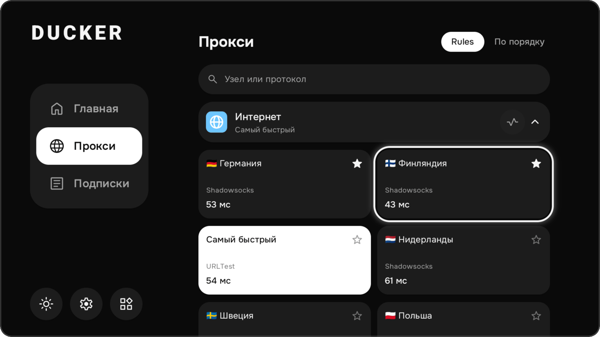
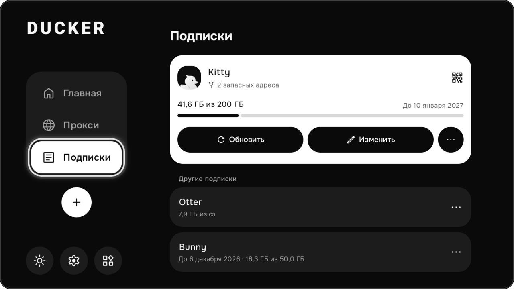

<div align="center">

<picture>
  <source media="(prefers-color-scheme: dark)" srcset="images/duck-dark.png">
  
</picture>

<br>

<picture>
  <source media="(prefers-color-scheme: dark)" srcset="images/wordmark-dark.svg">
  
</picture>

<br>

**Открытый VPN-клиент для Android и Android TV на ядре mihomo.**<br>
Одна кнопка, честное состояние, ничего лишнего на экране.

[English](../README.md) · **Русский** · [简体中文](README.zh-CN.md) · [فارسی](README.fa.md)

[](https://github.com/duckerapp/ducker/releases)
[](../LICENSE)
[](#установка)
[](https://t.me/ducker_news)

[Установка](#установка) · [Снимки](#снимки-экрана) · [Возможности](#возможности) · [Android TV](#android-tv) · [Провайдерам](#провайдерам) · [Планы](#что-дальше) · [Вопросы и ответы](FAQ.ru.md) · [Сообщество](#сообщество)


Android 8+ · Нужна своя подписка · [Скачать APK](https://github.com/duckerapp/ducker/releases) · [Скачать с GitLab](https://gitlab.com/duckerx/ducker/-/packages) · [Сайт](https://duckerapp.github.io/ducker/ru/)

<br>

<p align="center">
  
</p>

</div>

## Что это

ducker подключает телефон или телевизор к VPN через ядро
[mihomo](https://github.com/MetaCubeX/mihomo). Вы добавляете подписку от провайдера, нажимаете
одну кнопку и, если хотите, выбираете сервер.

ducker вырос из [Clash Meta for Android](https://github.com/MetaCubeX/ClashMetaForAndroid).
У него свой интерфейс Compose, работа с подписками и обновлениями приложения; основа службы
VPN и сборки пришла из CMFA. Сетевые протоколы предоставляет mihomo.

## Снимки экрана

У ducker два стиля: **Air**, светлый или тёмный, и **DUCKER Glass** (бета) — жидкое стекло поверх картинки на телефонах с Android 13 и новее. Переключается в **«Настройки» → «Оформление» → «Стиль»**.

<p align="center">
  <a href="images/ru/air.png"></a>
</p>

<p align="center"><sub>Air · Главная · Прокси · Узлы · Подписки</sub></p>

<p align="center">
  <a href="images/ru/glass.png"></a>
</p>

<p align="center"><sub>DUCKER Glass · Главная · Узлы · Все узлы · Главная на «Папоротнике»</sub></p>

<p align="center">
  <a href="images/ru/more.png"></a>
</p>

<p align="center"><sub>Возможности · Настройки · Подписки в стекле. Подписки и серверы на снимках выдуманы.</sub></p>

<p align="center">
  
  &nbsp;&nbsp;
  
</p>

<p align="center"><sub>Air: тема меняется волной по экрану. DUCKER Glass: карточка перетекает в новое состояние, когда VPN включается и выключается.</sub></p>

## Возможности

**На каждый день**

- **Экран под одну задачу.** На главной — кнопка включения, текущий узел с задержкой, срок
  подписки и остаток трафика. Всё остальное — на соседних вкладках, которые листаются пальцем.
- **Честное состояние.** Сразу после подъёма туннеля ducker проверяет, что трафик действительно
  идёт через узел. Если нет — карточка говорит об этом и предлагает переключиться на самый
  быстрый узел.
- **Ошибки словами.** Когда VPN остановился или подписка не обновилась, вы видите причину и что
  делать, а не код ошибки — даже если телефон сам закрыл ducker в фоне.
- **Подписка в любом виде.** Ссылка, QR-код или файл. Готовый конфиг mihomo применяется как
  есть; простой список ссылок `vless://`, `vmess://`, `ss://`, `trojan://` и подобных встаёт во
  встроенный профиль с маршрутизацией под Россию: заблокированное идёт через узел, российское —
  напрямую. Зашифрованная подписка открывается ключом от провайдера.
- **Узлы.** Группы из вашего конфига со своими значками, проверка задержки, избранное, поиск,
  сортировка по задержке и замер узла: потери, минимальная, средняя и наибольшая задержка.
- **Обновляется сам.** Новая версия ставится одним касанием с главной, а можно разрешить ставить её
  самой, ночью. Подробнее — в разделе «[Обновления](#обновления)».
- **Светлая и тёмная тема.** Чёрно-белый вид в обеих; тема меняется волной по экрану.

**«Возможности»** — страница под карточкой подписки на главной:

- **Мобильная сеть.** Своя подписка и свои серверы на случай, когда телефон ушёл с Wi-Fi; на Wi-Fi
  всё как обычно.
- **Подключения.** Какие приложения куда подключаются, вживую: приложение, сайт, правило, узел,
  скорость.
- **Раздача по Wi-Fi.** Интернет через VPN для ноутбука или другого телефона — через прокси в
  вашей сети.

Новые возможности будут появляться здесь же в следующих версиях.

**Когда нужно больше**

- **Приложения.** Выберите, какие приложения идут через VPN, а какие — мимо.
- **Мои правила.** Сайт, приложение, адрес, категорию или целую страну можно отправить через
  VPN, мимо него или заблокировать — не открывая YAML.
- **Редактор конфига.** Профиль правится прямо на устройстве; перед применением его проверяет
  ядро. Профиль используется как есть: ducker не переписывает ключи конфига молча.
- **Под рукой.** Виджеты на рабочем столе, плитка в шторке, ярлыки и, по желанию,
  [управление из Tasker и подобных приложений](#управление-из-других-приложений).
- **Не засыпает.** Автозапуск после перезагрузки и обновления приложения и пошаговая помощь с
  настройками Xiaomi, Samsung, Huawei, OPPO, vivo и Tecno, которые любят выключать VPN в фоне.
- **Приватность.** ducker можно скрыть из недавних приложений, замаскировать его значок под
  калькулятор, а ссылку подписки, её QR-код и редактор конфига — закрыть отпечатком пальца или
  PIN-кодом.
- **Новости провайдера.** Объявления провайдера — на главной, а за последние десять дней — под
  колокольчиком на вкладке «Подписки».
- **Языки.** Русский, английский, китайский (упрощённый), фарси, арабский, испанский,
  французский, индонезийский, португальский (Бразилия), турецкий и вьетнамский; фарси и арабский —
  с раскладкой справа налево.

**Под капотом**

- **mihomo v1.19.34**, собранный из исходников со свежими отпечатками uTLS.
- **Правки сообщества в ядре:** мультиплексор, совместимый с Xray (mux.cool с UDP и XUDP),
  REALITY как в Xray (ML-KEM, ML-DSA-65) с откатом для старых серверов и провайдер, который
  пропускает битый узел, а не отказывает целиком. Авторы и источники — в
  [CREDITS.ru.md](CREDITS.ru.md).
- **Встроенная панель [zashboard](https://github.com/Zephyruso/zashboard)** для диагностики. Она
  лежит внутри приложения и отдаётся ядром на самом устройстве; из сети ничего не скачивается.
- **Проверено на недорогом телефоне.** На Redmi Note 9S (2020 год, Android 12) приложение
  запускается примерно за 0,4 секунды при работающем VPN, а VPN продолжает работать, когда
  Android выгружает интерфейс.

**Конфигурация для каждой подписки.** «Подписки → ⋯ → Конфигурация»: «Из подписки» сохраняет
маршрутизацию провайдера, «ducker · Россия» берёт из подписки серверы, а правила — из шаблона:
российские сайты и приложения идут напрямую, остальное — через VPN. Смена заменяет ручные
правки конфига. Зашифрованные подписки в этом режиме не поддерживаются. При неудачной смене
остаётся прежняя рабочая конфигурация; прочитайте причину и повторите или вернитесь к источнику.
[Подробнее](FAQ.ru.md#шаблоны-конфигурации).

## Android TV

**С iPhone или телефона без ducker:** отсканируйте QR телевизора обычной камерой, откройте
страницу в браузере, вставьте ссылку подписки и нажмите «Отправить». На отправляющее устройство
ничего устанавливать не нужно. Используйте свою домашнюю сеть Wi-Fi и оставьте QR открытым
на телевизоре. С компьютера тоже можно открыть ссылку, распознанную из QR.
[Пошаговая инструкция](https://duckerapp.github.io/ducker/ru/users/tv/#browser-transfer).

Тот же APK работает на Android TV и Google TV.

- **Сделано под пульт.** Док слева, светящаяся рамка вокруг выбранного элемента, и экраны
  управляются стрелками пульта — вплоть до редактора конфига и журнала.
- **Не нужно набирать ссылку пультом.** Телевизор показывает QR-код; отсканируйте его в ducker на
  телефоне («Подписки» → «Добавить» → «Сканировать QR»), и подписка уйдёт на телевизор по
  домашней сети. Ссылка передаётся зашифрованной (AES-256-GCM) одноразовым ключом, который есть
  только в этом QR-коде, а телевизор слушает сеть, только пока код на экране.
- **Проверено на настоящих телевизорах.** Сообщения с других моделей очень пригодятся.

<p align="center">
  <a href="images/ru/tv-home.png"></a>
  <a href="images/ru/tv-proxies.png"></a>
</p>
<p align="center">
  <a href="images/ru/tv-profiles.png"></a>
  <a href="images/ru/tv-add.png"></a>
</p>

## Установка

1. Скачайте APK из [выпусков](https://github.com/duckerapp/ducker/releases):
   - `arm64-v8a` — почти любой телефон новее 2017 года;
   - `armeabi-v7a` — старые телефоны и многие телевизоры; берите, если первый не ставится.
2. Откройте файл. Android попросит разрешить установку из этого источника — для приложений не
   из Google Play это нормально.
3. Добавьте подписку: **«Подписки» → «Добавить» →** вставьте ссылку от провайдера, отсканируйте
   его QR-код или выберите файл. Ссылка вида `ducker://install-config?url=…` открывает то же окно
   прямо из чата или письма.
4. Нажмите кнопку включения на **«Главной»** и разрешите запрос Android на VPN.

Нужен Android 8 или новее. Что-то не получается? [Вопросы и ответы](FAQ.ru.md): как добавить
подписку, что делать, если VPN сам отключается или нет интернета, как прислать журнал.

### Обновления

Руками ducker ставится один раз, дальше он обновляется сам.

- **Сам проверяет** дважды в день и при открытии. Новая версия появляется на главной и в
  уведомлении вместе со списком изменений; одно касание — и она скачается и встанет, а VPN
  включится обратно сам.
- **«Обновлять автоматически»** (в настройках): новые версии скачиваются по Wi-Fi и ставятся, пока
  экран погашен, обычно ночью. Выключено, пока вы не согласитесь. Android 12 и новее; на Android
  8–11 система каждый раз спрашивает подтверждение.
- **«Бета-версии»** (в настройках): ранний доступ к тестовым выпускам. Удачная бета
  потом уходит всем тем же самым файлом.
- **Откуда.** Список версий берётся с GitHub, а если он не отвечает — с
  [зеркала на GitLab](https://gitlab.com/duckerx/ducker) или jsDelivr. Перед установкой ducker
  сверяет контрольную сумму файла и то, что он подписан тем же ключом, что и установленное
  приложение: чужой файл не встанет.

Android может откладывать фоновые проверки. Даже на Android 12+ Play Protect или правила устройства могут попросить подтверждение установки. Выключение beta не откатывает установленную версию; в stable переходит тот же APK.

### Проверка файла

- К каждому выпуску приложен `SHA256SUMS` — контрольные суммы его APK.
- В описании каждого выпуска есть ссылка на отчёт [VirusTotal](https://www.virustotal.com) для
  каждого APK: этот самый файл проверили десятки антивирусов. Свою копию можно загрузить туда
  самому и сравнить.
- Приложение собирается из этого репозитория; при сборке в него скачиваются готовый выпуск панели zashboard
  (сверяется по SHA-256) и базы стран и сайтов MetaCubeX/meta-rules-dat. Как собрать самому — в разделе
  «[Сборка](#сборка)».

Отчёт VirusTotal показывает результаты проверки этого файла на указанную дату и не гарантирует безопасность.

### Проверка разработчиков Google

По состоянию на ноябрь 2026 года ducker не зарегистрирован в программе верификации Google.
Первые ограничения касаются определённых магазинов на телефонах и планшетах в отдельных
странах; прямое скачивание APK в этот начальный этап не входит. Расширение намечено с 2027 года.
Условия зависят от страны, устройства и способа установки. Если Android просит разрешить
приложения непроверенных разработчиков, следуйте [инструкции](FAQ.ru.md#android-просит-разрешить-приложения-непроверенных-разработчиков).
Установка через `adb` не меняется. [Актуальные сведения Google](https://developer.android.com/developer-verification/guides/faq).

## Провайдерам

ducker работает с обычной подпиской mihomo. Он запрашивает её с User-Agent
`mihomo/<версия ядра> ducker/<версия приложения> (android)`, поэтому панели, которые отдают
клиентам mihomo конфиг, отдают его и ducker:

| Панель | ducker получает конфиг mihomo | Название, трафик, срок | Объявление | Лимит устройств | Свои заголовки ducker |
|---|---|---|---|---|---|
| Remnawave | по умолчанию | да | да | да | свои заголовки ответа |
| PasarGuard | по умолчанию | да | да | да | свои заголовки ответа |
| Marzban | по умолчанию | да | — | — | — |
| Marzneshin | добавьте правило `^mihomo` → `clash-meta` выше последнего или дайте ссылку `…/clash-meta` | да | — | — | — |
| 3x-ui | включите подписку Clash и её автоопределение или дайте ссылку `/mihomo/<subid>` | да | да | да | — |
| Hiddify | дайте ссылку `…/clashmeta/` | да | — | — | — |

<sub>Сверено с кодом панелей в ноябре 2026 года: Remnawave 3.4.8, PasarGuard 5.6.0, Marzban 0.8.4, Hiddify 14.2.0. Безлимитный тариф Hiddify показывается далёкой датой.</sub>

Если панель отдаёт простой список ссылок, ducker всё равно подключится: он поставит узлы во
встроенный профиль.

Сверх этого провайдер может оформить приложение под себя заголовками ответа на запрос подписки.
В [Remnawave](https://github.com/remnawave/panel) они задаются в настройках ответа подписки
(`customResponseHeaders`); код панели править не нужно.

<p align="center">
  <picture>
    <source media="(prefers-color-scheme: dark)" srcset="images/ru/brand-dark.png">
    
  </picture>
</p>

Справочник провайдера: [заголовки](https://duckerapp.github.io/ducker/ru/providers/headers/), [зеркала и зашифрованные подписки](https://duckerapp.github.io/ducker/ru/providers/start/).

## Приватность и безопасность

- **Без аналитики и отчётов разработчику.** Ни аналитики, ни рекламы, ни отчётов об ошибках разработчику. Своего
  сервера у проекта нет.
- **Что уходит в сеть:** запрос подписки вашему провайдеру, картинки, на которые ссылается
  подписка, проверка новой версии ducker и ваш трафик через серверы провайдера. Полный список — в
  [политике конфиденциальности](PRIVACY_POLICY.ru.md).
- **API ядра** слушает только `127.0.0.1` и закрыт случайным секретом, созданным при установке.
- **Журнал остаётся на устройстве,** пока вы сами его не выгрузите. Перед выгрузкой из него
  убираются адреса узлов, ключи и идентификатор устройства.
- **Доверие только системным сертификатам.** Сертификатом, поставленным на телефон руками,
  нельзя подменить картинки провайдера или ответ об обновлении.
- **Управление из других приложений выключено,** пока вы его не включите.

Нашли уязвимость? Сообщите, пожалуйста, закрыто: [SECURITY.ru.md](SECURITY.ru.md).

## Как делается проект

ducker делает один человек вместе с AI-агентом; владелец решает, что создавать.
Для проверки приложения используем автоматические тесты, эмуляторы и реальные устройства.
Исходный код открыт: его можно изучить и самостоятельно собрать приложение.

Шифрование и протоколы приходят из mihomo. Точная версия и изменения, включая совместимые
с Xray mux и REALITY, зафиксированы в подмодуле и открыты в форке
[duckerapp/mihomo](https://github.com/duckerapp/mihomo), ветка `ducker`; ещё
несколько исправлений — в двух малых форках, [duckerapp/utls](https://github.com/duckerapp/utls) и
[duckerapp/sing-mux](https://github.com/duckerapp/sing-mux).

## Управление из других приложений

Для Tasker, ярлыков и подобных инструментов. Сначала включите **«Настройки» → «Приватность» →
«Управление из других приложений»**: по умолчанию оно выключено, в том числе после обновления уже установленного
приложения. Разрешение действует для всех приложений, способных отправить эти команды. Виджеты,
плитка и ярлыки самого ducker работают без него.

| Действие | Интент |
|---|---|
| включить | `am start -a app.ducker.android.action.START_CLASH` |
| выключить | `am start -a app.ducker.android.action.STOP_CLASH` |
| переключить | `am start -a app.ducker.android.action.TOGGLE_CLASH` |
| добавить подписку | `ducker://install-config?url=<ссылка>` |

## Что дальше

- **Клиент для компьютера** — Windows, Linux и macOS.
- **«Только через VPN»:** у выбранных приложений нет интернета вовсе, пока VPN выключен.

Сроков пока нет. Версия для iOS пока не планируется.

Что уже сделано, по версиям — в [списке изменений](CHANGELOG.ru.md).

## Сборка

Нужны JDK 21, Android SDK (platform 37, NDK 29.0.14206865), git, curl и patch; Go сборка скачивает сама.

```
git clone --recurse-submodules https://github.com/duckerapp/ducker.git
cd ducker
./gradlew :app:assembleMetaRelease
```

Без `--recurse-submodules` не соберётся: ядро подключено подмодулем. Собранное подписывается
отладочным ключом; свой ключ задаётся файлом `signing.properties` в корне репозитория
(`keystore.path`, `keystore.password`, `key.alias`, `key.password`). `./scripts/smoke.sh`
проверяет сборку на подключённом телефоне.

Подробности — в [CONTRIBUTING.ru.md](CONTRIBUTING.ru.md); где что лежит в коде — в
[карте кода](ARCHITECTURE.md) (на английском).

## Благодарности

- [MetaCubeX/mihomo](https://github.com/MetaCubeX/mihomo) — ядро;
- [MetaCubeX/ClashMetaForAndroid](https://github.com/MetaCubeX/ClashMetaForAndroid) — основа службы VPN
  и сборки, с которой начинался ducker;
- [Zephyruso/zashboard](https://github.com/Zephyruso/zashboard) — встроенная веб-панель;
- авторы правок ядра и идей, которые мы взяли, — все названы в [CREDITS.ru.md](CREDITS.ru.md).

## Сообщество

- [Канал в Telegram](https://t.me/ducker_news) — выпуски и новости;
- [Чат в Telegram](https://t.me/ducker_chat) — вопросы и обсуждение;
- [Issues](https://github.com/duckerapp/ducker/issues) — ошибки и идеи;
- [duckermihomo@proton.me](mailto:duckermihomo@proton.me) — почта, если Telegram и GitHub не подходят;
- [CONTRIBUTING.ru.md](CONTRIBUTING.ru.md) — как сообщить об ошибке, собрать приложение и прислать
  изменение.

Проект ведёт один человек, поэтому помощь важна: сообщения об ошибках, проверка на своём
телефоне или телевизоре, переводы — особенно от носителей языков из списка выше.

Поддержать проект деньгами: [CryptoBot](https://t.me/send?start=IVviDBljozrs) в Telegram, любая монета, или на кошелёк — адреса
на [сайте](https://duckerapp.github.io/ducker/ru/support/donate/) и в приложении: «Настройки» → «Поддержать проект».

## Лицензия

[GPL-3.0](../LICENSE), как у родительского проекта.
