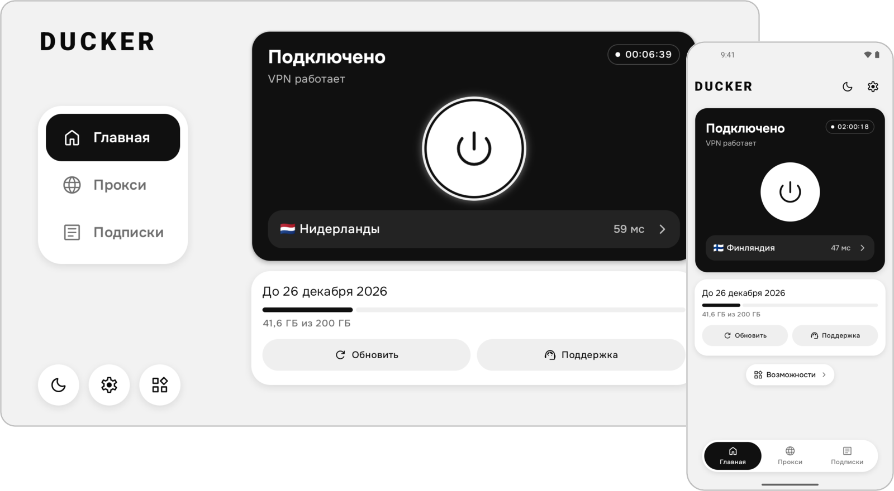
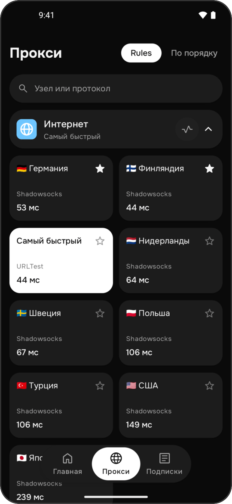

<div align="center">

<picture>
  <source media="(prefers-color-scheme: dark)" srcset="images/duck-dark.png">
  
</picture>

<br>

<picture>
  <source media="(prefers-color-scheme: dark)" srcset="images/wordmark-dark.svg">
  
</picture>

<br>

**Открытый VPN-клиент для Android и Android TV на ядре mihomo.**<br>
Одна кнопка, честное состояние, ничего лишнего на экране.

[English](../README.md) · **Русский** · [简体中文](README.zh-CN.md) · [فارسی](README.fa.md)

[](https://github.com/duckerapp/ducker/releases)
[](../LICENSE)
[](#установка)
[](https://t.me/ducker_mihomo)

[Установка](#установка) · [Снимки](#снимки-экрана) · [Возможности](#возможности) · [Android TV](#android-tv) · [Провайдерам](#провайдерам) · [Вопросы и ответы](FAQ.ru.md) · [Сообщество](#сообщество)

<br>

<picture>
  <source media="(prefers-color-scheme: dark)" srcset="images/ru/hero-dark.png">
  
</picture>

</div>

## Что это

ducker подключает телефон или телевизор к VPN через ядро
[mihomo](https://github.com/MetaCubeX/mihomo). Вы добавляете подписку от провайдера, нажимаете
одну кнопку и, если хотите, выбираете сервер.

Это форк [Clash Meta for Android](https://github.com/MetaCubeX/ClashMetaForAndroid): служба VPN и
связка с ядром — оттуда, интерфейс написан заново на Jetpack Compose. Бесплатно, без рекламы и
аналитики, лицензия GPL-3.0.

## Снимки экрана

<p align="center">
  <a href="images/ru/phone-home.png"></a>
  <a href="images/ru/phone-proxies.png"></a>
  <a href="images/ru/phone-subscriptions.png"></a>
  <a href="images/ru/phone-settings.png"></a>
</p>

<p align="center"><sub>Главная · Прокси · Подписки · Настройки. Провайдер и его серверы на снимках выдуманы.</sub></p>

<p align="center">
  
</p>

<p align="center"><sub>Тема меняется волной по экрану.</sub></p>

## Возможности

**На каждый день**

- **Экран под одну задачу.** На главной — кнопка включения, текущий узел с задержкой, срок
  подписки и остаток трафика. Всё остальное — на соседних вкладках, которые листаются пальцем.
- **Честное состояние.** Сразу после подъёма туннеля ducker проверяет, что трафик действительно
  идёт через узел. Если нет — карточка говорит об этом и предлагает переключиться на самый
  быстрый узел.
- **Ошибки словами.** Когда VPN остановился или подписка не обновилась, вы видите причину и что
  делать, а не код ошибки.
- **Подписка в любом виде.** Ссылка, QR-код или файл. Готовый конфиг mihomo применяется как
  есть; простой список ссылок `vless://`, `vmess://`, `ss://`, `trojan://` и подобных встаёт во
  встроенный профиль с маршрутизацией под Россию: заблокированное идёт через узел, российское —
  напрямую.
- **Узлы.** Группы из вашего конфига, проверка задержки, избранное, поиск, сортировка по
  задержке и замер узла: потери, минимальная, средняя и наибольшая задержка.
- **Светлая и тёмная тема.** Чёрно-белый вид в обеих; тема меняется волной по экрану.

**Когда нужно больше**

- **Приложения.** Выберите, какие приложения идут через VPN, а какие — мимо.
- **Мои правила.** Сайт, приложение, адрес, категорию или целую страну можно отправить через
  VPN, мимо него или заблокировать — не открывая YAML.
- **Редактор конфига.** Профиль правится прямо на устройстве; перед применением его проверяет
  ядро. Профиль используется как есть: ducker не переписывает ключи конфига молча.
- **Под рукой.** Виджеты на рабочем столе, плитка в шторке, ярлыки и, по желанию,
  [управление из Tasker и подобных приложений](#управление-из-других-приложений).
- **Не засыпает.** Автозапуск после перезагрузки и обновления приложения и пошаговая помощь с
  настройками Xiaomi, Samsung, Huawei, OPPO, vivo и Tecno, которые любят выключать VPN в фоне.
- **Приватность.** ducker можно скрыть из недавних приложений или замаскировать его значок под
  калькулятор.
- **Языки.** Русский и английский; китайский (упрощённый) и фарси — в планах.

**Под капотом**

- **mihomo v1.19.32**, собранный из исходников со свежими отпечатками uTLS.
- **Правки сообщества в ядре:** мультиплексор, совместимый с Xray (mux.cool с UDP и XUDP),
  REALITY как в Xray (ML-KEM, ML-DSA-65) с откатом для старых серверов и провайдер, который
  пропускает битый узел, а не отказывает целиком. Авторы и источники — в
  [CREDITS.md](CREDITS.md).
- **Встроенная панель [zashboard](https://github.com/Zephyruso/zashboard)** для диагностики. Она
  лежит внутри приложения и отдаётся ядром на самом устройстве; из сети ничего не скачивается.
- **Проверено на недорогом телефоне.** На Redmi Note 9S (2020 год, Android 12) приложение
  запускается примерно за 0,4 секунды при работающем VPN, а VPN продолжает работать, когда
  Android выгружает интерфейс.

## Android TV

Тот же APK работает на Android TV и Google TV.

- **Сделано под пульт.** Док слева, светящаяся рамка вокруг выбранного элемента; главные экраны —
  «Главная», «Прокси», «Подписки» — управляются стрелками пульта.
- **Не нужно набирать ссылку пультом.** Телевизор показывает QR-код; отсканируйте его в ducker на
  телефоне («Подписки» → **+** → «Сканировать QR»), и подписка уйдёт на телевизор по домашней
  сети. Ссылка передаётся зашифрованной (AES-256-GCM) одноразовым ключом, который есть только в
  этом QR-коде, а телевизор слушает сеть, только пока код на экране.
- **Ещё в работе.** Поддержка телевизоров новая. Часть экранов из настроек пока неудобна с
  пульта, и проверялась она в основном в эмуляторе — сообщения с настоящих телевизоров очень
  нужны.

<p align="center">
  <a href="images/ru/tv-proxies.png"></a>
  <a href="images/ru/tv-add.png"></a>
</p>

## Установка

1. Скачайте APK из [выпусков](https://github.com/duckerapp/ducker/releases):
   - `arm64-v8a` — почти любой телефон новее 2017 года;
   - `armeabi-v7a` — старые телефоны и многие телевизоры; берите, если первый не ставится.
2. Откройте файл. Android попросит разрешить установку из этого источника — для приложений не
   из Google Play это нормально.
3. Добавьте подписку: **«Подписки» → + →** вставьте ссылку от провайдера, отсканируйте его
   QR-код или выберите файл. Ссылка вида `ducker://install-config?url=…` открывает то же окно
   прямо из чата или письма.
4. Нажмите кнопку включения на **«Главной»** и разрешите запрос Android на VPN.

Нужен Android 10 или новее. К каждому выпуску приложен файл `SHA256SUMS` с контрольными суммами
APK.

Что-то не получается? [Вопросы и ответы](FAQ.ru.md): как добавить подписку, что делать, если VPN
сам отключается или нет интернета, как прислать журнал.

## Провайдерам

ducker работает с обычной подпиской mihomo. Сверх этого провайдер может оформить приложение под
себя заголовками ответа на запрос подписки. В [Remnawave](https://github.com/remnawave/panel)
они задаются в настройках ответа подписки (`customResponseHeaders`); код панели править не нужно.

<p align="center">
  <picture>
    <source media="(prefers-color-scheme: dark)" srcset="images/ru/brand-dark.png">
    
  </picture>
</p>

- **`ducker-brand-name: <текст>`** — название провайдера в шапке главной вместо надписи DUCKER.
  Оно же — в уведомлении и на плитке в шторке.
- **`ducker-brand-logo: <картинка>`** — логотип рядом с названием на главной и на карточке
  подписки. Ссылка `https://…` или сама картинка строкой `data:…;base64,…`; PNG, JPEG, WebP или
  SVG. Не загрузился — стоит значок ducker.
- **`ducker-buy-url: <ссылка>`** — кнопка **«Продлить»** на карточке подписки, когда до конца
  меньше трёх дней, осталось меньше 10 % трафика или срок вышел. Та же ссылка — в уведомлении о
  скором конце подписки. Без заголовка берётся `profile-web-page-url`.
- **`ducker-global: off`** — прячет переключатель Global/Rules на вкладке «Прокси»; режим
  остаётся тем, что задан в конфиге.
- **`ducker-local-proxy: off`** — туннель поднимается с закрытыми локальными портами конфига
  (`mixed-port`, `port`, `socks-port`, `redir-port`, `tproxy-port`) и без раздела `listeners`:
  другие приложения на телефоне не находят прокси на `127.0.0.1`. Сам конфиг не переписывается.
  Открыть порт заголовком нельзя.
- **`ducker-override-user: on | off`** — зарезервирован под настройки, которые провайдер задаёт
  заголовками. Приложение его читает, но пока он ни на что не влияет.

Общие правила:

- Регистр в имени заголовка не важен.
- Текст с кириллицей или переводом строки передаётся как `base64:<…>` (UTF-8) — так же, как
  Remnawave отдаёт `announce`.
- Значение из одного прочерка `-` значит «не задано»: панель не даёт сохранить пустой заголовок,
  а прочерком можно убрать свой.
- Заголовки меняют только вид и поведение из списка выше. К безопасности — секрету API ядра,
  журналам, адресу обновлений приложения — у них доступа нет.

Кроме них, ducker понимает общепринятые заголовки подписки: `profile-title`,
`profile-update-interval`, `profile-web-page-url`, `support-url`, `announce`,
`subscription-userinfo`, `subscription-refill-date`.

**Лимит устройств.** С каждым запросом подписки ducker отправляет устойчивый идентификатор
устройства в `x-hwid` и вместе с ним `x-device-os`, `x-ver-os` и `x-device-model` — так панель
считает устройства. Человек видит этот идентификатор в **«Настройки» → «Идентификатор
устройства»** и может его выключить. Идентификатор отправляется только
по HTTPS.

**Установка в одно касание.** `ducker://install-config?url=<ссылка подписки>` открывает окно
добавления подписки с уже вставленной ссылкой; до подтверждения ничего не скачивается.

## Приватность и безопасность

- **Ничего не собирается.** Ни аналитики, ни рекламы, ни отчётов об ошибках разработчику. Своего
  сервера у проекта нет.
- **Что уходит в сеть:** запрос подписки вашему провайдеру, картинки, на которые ссылается
  подписка, и ваш трафик через серверы провайдера. Полный список — в
  [политике конфиденциальности](../PRIVACY_POLICY.md).
- **API ядра** слушает только `127.0.0.1` и закрыт случайным секретом, созданным при установке.
- **Журнал остаётся на устройстве,** пока вы сами его не выгрузите. Перед выгрузкой из него
  убираются адреса узлов, ключи и идентификатор устройства.
- **Доверие только системным сертификатам.** Сертификатом, поставленным на телефон руками,
  нельзя подменить картинки провайдера или ответ об обновлении.
- **Управление из других приложений выключено,** пока вы его не включите.

Нашли уязвимость? Сообщите, пожалуйста, закрыто: [SECURITY.md](../SECURITY.md).

## Как делается проект

ducker делает один человек вместе с ИИ-ассистентом. Код пишет Claude — модель компании
Anthropic; что делать, решает владелец проекта. Каждое изменение собирается, проходит тесты и
проверяется на настоящих устройствах, прежде чем попасть в выпуск, а сборку можно повторить
самому из этого репозитория.

Шифрование и протоколы — не наши: они приходят из ядра mihomo. Наши правки к нему — 21 коммит
поверх v1.19.32, из них 13 — правки сообщества для мультиплексора, совместимого с Xray, и
REALITY. Они открыты в форке [duckerapp/mihomo](https://github.com/duckerapp/mihomo), ветка `ducker`; ещё четыре
коммита — в двух малых форках, [duckerapp/utls](https://github.com/duckerapp/utls) и
[duckerapp/sing-mux](https://github.com/duckerapp/sing-mux).

## Управление из других приложений

Для Tasker, ярлыков и подобных инструментов. Сначала включите **«Настройки» → «Управление из
других приложений»**: по умолчанию оно выключено, в том числе после обновления уже установленного
приложения. Разрешение действует для всех приложений, способных отправить эти команды. Виджеты,
плитка и ярлыки самого ducker работают без него.

| Действие | Интент |
|---|---|
| включить | `am start -a app.ducker.android.action.START_CLASH` |
| выключить | `am start -a app.ducker.android.action.STOP_CLASH` |
| переключить | `am start -a app.ducker.android.action.TOGGLE_CLASH` |
| добавить подписку | `ducker://install-config?url=<ссылка>` |

## Что дальше

- Android TV: остальные экраны под пульт и первый экран с QR-кодом.
- Китайский (упрощённый) и фарси, включая раскладку справа налево.
- Уведомление о новой версии внутри приложения.
- Клиенты для Linux и Windows планируются отдельным проектом; сроков пока нет.

Что уже сделано, по версиям — в [списке изменений](CHANGELOG.ru.md).

## Сборка

Нужны JDK 21, Android SDK (platform 37, NDK 29.0.14206865), Go 1.26 или новее и git.

```
git clone --recurse-submodules https://github.com/duckerapp/ducker.git
cd ducker
./gradlew :app:assembleMetaRelease
```

Без `--recurse-submodules` не соберётся: ядро подключено подмодулем. Собранное подписывается
отладочным ключом; свой ключ задаётся файлом `signing.properties` в корне репозитория
(`keystore.path`, `keystore.password`, `key.alias`, `key.password`). `./scripts/smoke.sh`
проверяет сборку на подключённом телефоне.

Подробности — в [CONTRIBUTING.ru.md](CONTRIBUTING.ru.md); где что лежит в коде — в
[карте кода](ARCHITECTURE.md) (на английском).

## Благодарности

- [MetaCubeX/mihomo](https://github.com/MetaCubeX/mihomo) — ядро;
- [MetaCubeX/ClashMetaForAndroid](https://github.com/MetaCubeX/ClashMetaForAndroid) — служба VPN,
  сборка и всё, что под интерфейсом;
- [Zephyruso/zashboard](https://github.com/Zephyruso/zashboard) — встроенная веб-панель;
- авторы правок ядра и идей, которые мы взяли, — все названы в [CREDITS.md](CREDITS.md).

## Сообщество

- [Канал в Telegram](https://t.me/ducker_mihomo) — выпуски и новости;
- [Чат в Telegram](https://t.me/ducker_community) — вопросы и обсуждение;
- [Issues](https://github.com/duckerapp/ducker/issues) — ошибки и идеи;
- [CONTRIBUTING.ru.md](CONTRIBUTING.ru.md) — как сообщить об ошибке, собрать приложение и прислать
  изменение.

Проект ведёт один человек, поэтому помощь важна: сообщения об ошибках, проверка на своём
телефоне или телевизоре, переводы — особенно от носителей китайского и фарси.

## Лицензия

[GPL-3.0](../LICENSE), как у родительского проекта.
