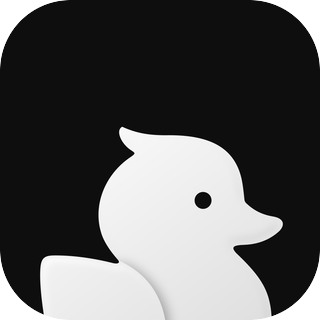
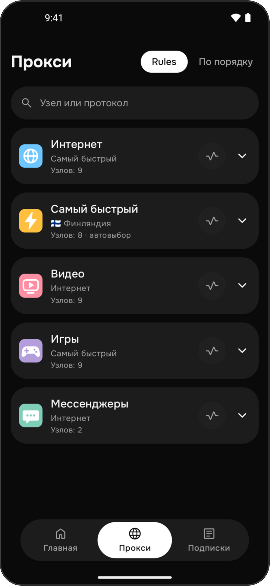
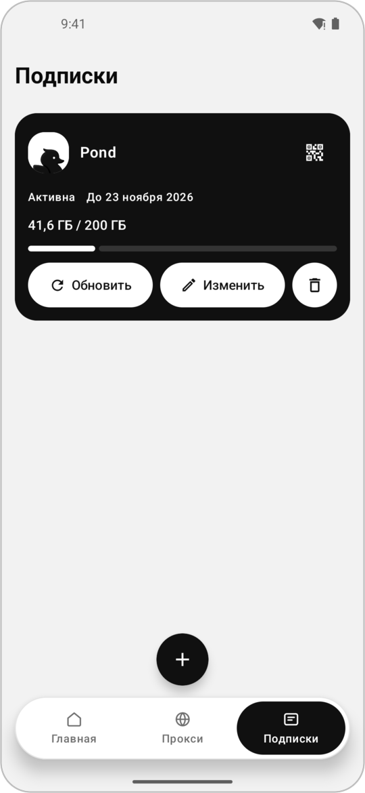
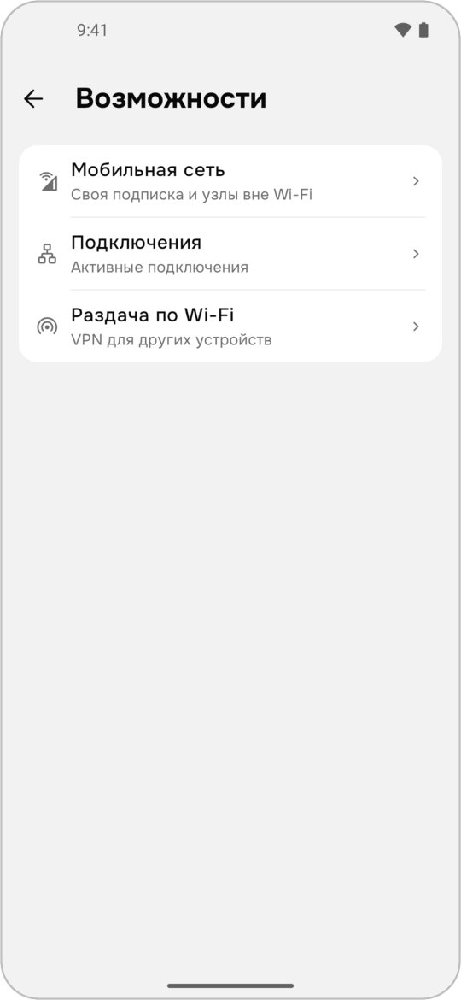
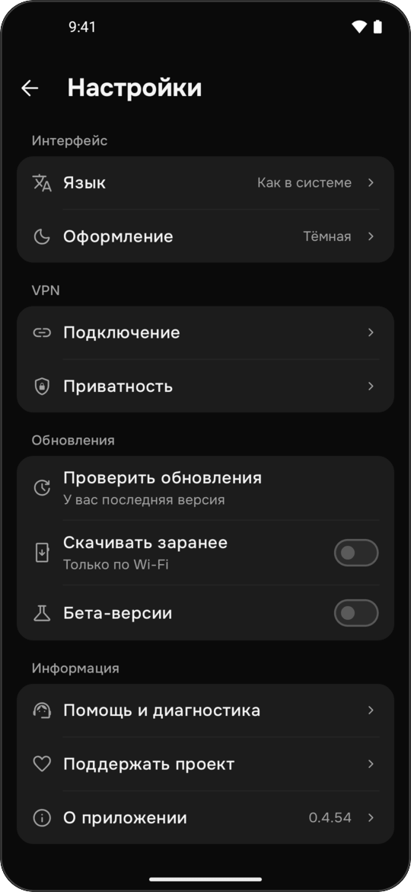
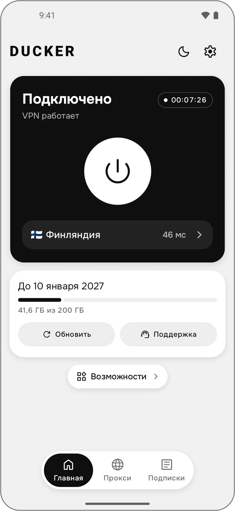
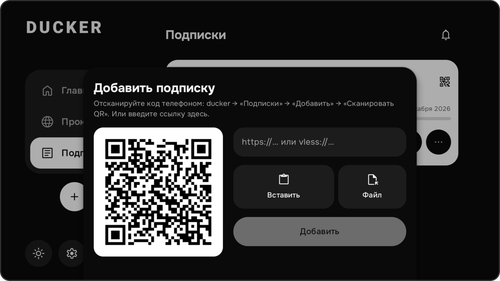
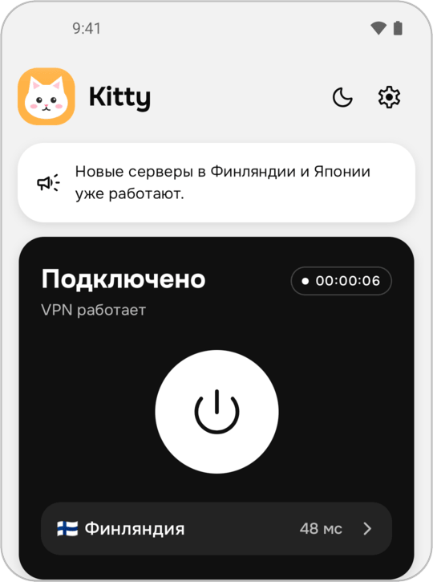

<div align="center">

<picture>
  <source media="(prefers-color-scheme: dark)" srcset="images/duck-dark.png">
  
</picture>

<br>

<picture>
  <source media="(prefers-color-scheme: dark)" srcset="images/wordmark-dark.svg">
  
</picture>

<br>

**Открытый VPN-клиент для Android и Android TV на ядре mihomo.**<br>
Одна кнопка, честное состояние, ничего лишнего на экране.

[English](../README.md) · **Русский** · [简体中文](README.zh-CN.md) · [فارسی](README.fa.md)

[](https://github.com/duckerapp/ducker/releases)
[](../LICENSE)
[](#установка)
[](https://t.me/ducker_mihomo)

[Установка](#установка) · [Снимки](#снимки-экрана) · [Возможности](#возможности) · [Android TV](#android-tv) · [Провайдерам](#провайдерам) · [Планы](#что-дальше) · [Вопросы и ответы](FAQ.ru.md) · [Сообщество](#сообщество)

<br>

<picture>
  <source media="(prefers-color-scheme: dark)" srcset="images/ru/hero-dark.png">
  
</picture>

</div>

## Что это

ducker подключает телефон или телевизор к VPN через ядро
[mihomo](https://github.com/MetaCubeX/mihomo). Вы добавляете подписку от провайдера, нажимаете
одну кнопку и, если хотите, выбираете сервер.

ducker начинался как форк [Clash Meta for Android](https://github.com/MetaCubeX/ClashMetaForAndroid) и с тех пор
переписан почти целиком: в код добавлено около 52 тысяч строк и убрано около 10 тысяч, а из
файлов CMFA без изменений осталась примерно треть. Интерфейс на Jetpack Compose, работа с
подписками, обновления, версия для телевизора и многое в службе VPN — свои; от CMFA остались
основа службы и связка с ядром. Бесплатно, без рекламы и аналитики, лицензия GPL-3.0.

## Снимки экрана

<p align="center">
  <a href="images/ru/phone-home.png"></a>
  <a href="images/ru/phone-groups.png"></a>
  <a href="images/ru/phone-subscriptions.png"></a>
</p>
<p align="center">
  <a href="images/ru/phone-proxies.png"></a>
  <a href="images/ru/phone-features.png"></a>
  <a href="images/ru/phone-settings.png"></a>
</p>

<p align="center"><sub>Главная · Группы · Подписки · Узлы · Возможности · Настройки. Подписки и серверы на снимках выдуманы.</sub></p>

<p align="center">
  
</p>

<p align="center"><sub>Тема меняется волной по экрану.</sub></p>

## Возможности

**На каждый день**

- **Экран под одну задачу.** На главной — кнопка включения, текущий узел с задержкой, срок
  подписки и остаток трафика. Всё остальное — на соседних вкладках, которые листаются пальцем.
- **Честное состояние.** Сразу после подъёма туннеля ducker проверяет, что трафик действительно
  идёт через узел. Если нет — карточка говорит об этом и предлагает переключиться на самый
  быстрый узел.
- **Ошибки словами.** Когда VPN остановился или подписка не обновилась, вы видите причину и что
  делать, а не код ошибки — даже если телефон сам закрыл ducker в фоне.
- **Подписка в любом виде.** Ссылка, QR-код или файл. Готовый конфиг mihomo применяется как
  есть; простой список ссылок `vless://`, `vmess://`, `ss://`, `trojan://` и подобных встаёт во
  встроенный профиль с маршрутизацией под Россию: заблокированное идёт через узел, российское —
  напрямую. Зашифрованная подписка открывается ключом от провайдера.
- **Узлы.** Группы из вашего конфига со своими значками, проверка задержки, избранное, поиск,
  сортировка по задержке и замер узла: потери, минимальная, средняя и наибольшая задержка.
- **Обновляется сам.** Новая версия ставится одним касанием с главной, а можно разрешить ставить её
  самой, ночью. Подробнее — в разделе «[Обновления](#обновления)».
- **Светлая и тёмная тема.** Чёрно-белый вид в обеих; тема меняется волной по экрану.

**«Возможности»** — страница под карточкой подписки на главной:

- **Мобильная сеть.** Своя подписка и свои серверы на случай, когда телефон ушёл с Wi-Fi; на Wi-Fi
  всё как обычно.
- **Подключения.** Какие приложения куда подключаются, вживую: приложение, сайт, правило, узел,
  скорость.
- **Раздача по Wi-Fi.** Интернет через VPN для ноутбука или другого телефона — через прокси в
  вашей сети.

Новые возможности будут появляться здесь же в следующих версиях.

**Когда нужно больше**

- **Приложения.** Выберите, какие приложения идут через VPN, а какие — мимо.
- **Мои правила.** Сайт, приложение, адрес, категорию или целую страну можно отправить через
  VPN, мимо него или заблокировать — не открывая YAML.
- **Редактор конфига.** Профиль правится прямо на устройстве; перед применением его проверяет
  ядро. Профиль используется как есть: ducker не переписывает ключи конфига молча.
- **Под рукой.** Виджеты на рабочем столе, плитка в шторке, ярлыки и, по желанию,
  [управление из Tasker и подобных приложений](#управление-из-других-приложений).
- **Не засыпает.** Автозапуск после перезагрузки и обновления приложения и пошаговая помощь с
  настройками Xiaomi, Samsung, Huawei, OPPO, vivo и Tecno, которые любят выключать VPN в фоне.
- **Приватность.** ducker можно скрыть из недавних приложений, замаскировать его значок под
  калькулятор, а ссылку подписки, её QR-код и редактор конфига — закрыть отпечатком пальца или
  PIN-кодом.
- **Новости провайдера.** Объявления провайдера — на главной, а за последние десять дней — под
  колокольчиком на вкладке «Подписки».
- **Языки.** Русский, английский, китайский (упрощённый), фарси, арабский, испанский,
  французский, индонезийский, португальский (Бразилия), турецкий и вьетнамский; фарси и арабский —
  с раскладкой справа налево.

**Под капотом**

- **mihomo v1.19.33**, собранный из исходников со свежими отпечатками uTLS.
- **Правки сообщества в ядре:** мультиплексор, совместимый с Xray (mux.cool с UDP и XUDP),
  REALITY как в Xray (ML-KEM, ML-DSA-65) с откатом для старых серверов и провайдер, который
  пропускает битый узел, а не отказывает целиком. Авторы и источники — в
  [CREDITS.ru.md](CREDITS.ru.md).
- **Встроенная панель [zashboard](https://github.com/Zephyruso/zashboard)** для диагностики. Она
  лежит внутри приложения и отдаётся ядром на самом устройстве; из сети ничего не скачивается.
- **Проверено на недорогом телефоне.** На Redmi Note 9S (2020 год, Android 12) приложение
  запускается примерно за 0,4 секунды при работающем VPN, а VPN продолжает работать, когда
  Android выгружает интерфейс.

## Android TV

Тот же APK работает на Android TV и Google TV.

- **Сделано под пульт.** Док слева, светящаяся рамка вокруг выбранного элемента, и экраны
  управляются стрелками пульта — вплоть до редактора конфига и журнала.
- **Не нужно набирать ссылку пультом.** Телевизор показывает QR-код; отсканируйте его в ducker на
  телефоне («Подписки» → «Добавить» → «Сканировать QR»), и подписка уйдёт на телевизор по
  домашней сети. Ссылка передаётся зашифрованной (AES-256-GCM) одноразовым ключом, который есть
  только в этом QR-коде, а телевизор слушает сеть, только пока код на экране.
- **Проверено на настоящих телевизорах.** Сообщения с других моделей очень пригодятся.

<p align="center">
  <a href="images/ru/tv-proxies.png"></a>
  <a href="images/ru/tv-add.png"></a>
</p>

## Установка

1. Скачайте APK из [выпусков](https://github.com/duckerapp/ducker/releases):
   - `arm64-v8a` — почти любой телефон новее 2017 года;
   - `armeabi-v7a` — старые телефоны и многие телевизоры; берите, если первый не ставится.
2. Откройте файл. Android попросит разрешить установку из этого источника — для приложений не
   из Google Play это нормально.
3. Добавьте подписку: **«Подписки» → «Добавить» →** вставьте ссылку от провайдера, отсканируйте
   его QR-код или выберите файл. Ссылка вида `ducker://install-config?url=…` открывает то же окно
   прямо из чата или письма.
4. Нажмите кнопку включения на **«Главной»** и разрешите запрос Android на VPN.

Нужен Android 8 или новее. Что-то не получается? [Вопросы и ответы](FAQ.ru.md): как добавить
подписку, что делать, если VPN сам отключается или нет интернета, как прислать журнал.

### Обновления

Руками ducker ставится один раз, дальше он обновляется сам.

- **Сам проверяет** дважды в день и при открытии. Новая версия появляется на главной и в
  уведомлении вместе со списком изменений; одно касание — и она скачается и встанет, а VPN
  включится обратно сам.
- **«Обновлять автоматически»** (в настройках): новые версии скачиваются по Wi-Fi и ставятся, пока
  экран погашен, обычно ночью. Выключено, пока вы не согласитесь. Android 12 и новее; на Android
  10–11 система каждый раз спрашивает подтверждение.
- **«Бета-версии»** (в настройках): новые версии на несколько дней раньше остальных. Удачная бета
  потом уходит всем тем же самым файлом.
- **Откуда.** Список версий берётся с GitHub, а если он не отвечает — с
  [зеркала на GitLab](https://gitlab.com/duckerx/ducker) или jsDelivr. Перед установкой ducker
  сверяет контрольную сумму файла и то, что он подписан тем же ключом, что и установленное
  приложение: чужой файл не встанет.

### Проверка файла

- К каждому выпуску приложен `SHA256SUMS` — контрольные суммы его APK.
- В описании каждого выпуска есть ссылка на отчёт [VirusTotal](https://www.virustotal.com) для
  каждого APK: этот самый файл проверили десятки антивирусов. Свою копию можно загрузить туда
  самому и сравнить.
- Приложение собирается из этого репозитория; при сборке в него скачиваются готовый выпуск панели zashboard
  (сверяется по SHA-256) и базы стран и сайтов MetaCubeX/meta-rules-dat. Как собрать самому — в разделе
  «[Сборка](#сборка)».

### Проверка разработчиков Google

С 2027 года сертифицированные телефоны и телевизоры на Android ставят приложения не из Google Play,
только если их разработчик зарегистрирован в Google; в Бразилии, Индонезии, Сингапуре и Таиланде
это началось ещё в 2026-м. ducker не зарегистрирован. На таких устройствах Android один раз
попросит разрешить приложения непроверенных разработчиков: для этого нужны PIN-код, перезагрузка
и сутки ожидания. После этого ducker ставится и обновляется как раньше; если снова выключить эту
настройку, обновления ducker перестанут ставиться. Установки через `adb` это не касается.
Подробнее — в [вопросах и ответах](FAQ.ru.md#android-просит-разрешить-приложения-непроверенных-разработчиков).

## Провайдерам

ducker работает с обычной подпиской mihomo. Он запрашивает её с User-Agent
`mihomo/<версия ядра> ducker/<версия приложения> (android)`, поэтому панели, которые отдают
клиентам mihomo конфиг, отдают его и ducker:

| Панель | ducker получает конфиг mihomo | Название, трафик, срок | Объявление | Лимит устройств | Свои заголовки ducker |
|---|---|---|---|---|---|
| Remnawave | по умолчанию | да | да | да | свои заголовки ответа |
| PasarGuard | по умолчанию | да | да | да | свои заголовки ответа |
| Marzban | по умолчанию | да | — | — | — |
| Marzneshin | добавьте правило `^mihomo` → `clash-meta` выше последнего или дайте ссылку `…/clash-meta` | да | — | — | — |
| 3x-ui | включите подписку Clash и её автоопределение или дайте ссылку `/mihomo/<subid>` | да | да | да | — |
| Hiddify | дайте ссылку `…/clashmeta/` | да | — | — | — |

<sub>Сверено с кодом панелей в ноябре 2026 года: Remnawave 3.4.8, PasarGuard 5.6.0, Marzban 0.8.4, Hiddify 14.2.0. Безлимитный тариф Hiddify показывается далёкой датой.</sub>

Если панель отдаёт простой список ссылок, ducker всё равно подключится: он поставит узлы во
встроенный профиль.

Сверх этого провайдер может оформить приложение под себя заголовками ответа на запрос подписки.
В [Remnawave](https://github.com/remnawave/panel) они задаются в настройках ответа подписки
(`customResponseHeaders`); код панели править не нужно.

<p align="center">
  <picture>
    <source media="(prefers-color-scheme: dark)" srcset="images/ru/brand-dark.png">
    
  </picture>
</p>

- **`ducker-brand-name: <текст>`** — название провайдера в шапке главной вместо надписи DUCKER.
  Оно же — в уведомлении и на плитке в шторке.
- **`ducker-brand-logo: <картинка>`** — логотип рядом с названием на главной и на карточке
  подписки. Ссылка `https://…` или сама картинка строкой `data:…;base64,…`; PNG, JPEG, WebP или
  SVG. Не загрузился — стоит значок ducker.
- **`ducker-buy-url: <ссылка>`** — кнопка **«Продлить»** на карточке подписки, когда до конца
  меньше трёх дней, осталось меньше 10 % трафика или срок вышел. Та же ссылка — в уведомлении о
  скором конце подписки. Без заголовка берётся `support-url`, а без него —
  `profile-web-page-url`.
- **`ducker-global: off`** — прячет переключатель Global/Rules на вкладке «Прокси»; режим
  остаётся тем, что задан в конфиге.
- **`ducker-local-proxy: off`** — туннель поднимается с закрытыми локальными портами конфига
  (`mixed-port`, `port`, `socks-port`, `redir-port`, `tproxy-port`), без раздела `listeners` и без
  DNS-сервера из `dns.listen`: другие приложения на телефоне не находят на `127.0.0.1` ни прокси, ни
  DNS-сервер. Сам конфиг не переписывается.
  Другие значения ничего не меняют: порты остаются как в конфиге.
- **`ducker-share: off`** — «Раздача по Wi-Fi» закрыта: карточка говорит, что её закрыл провайдер,
  а включённая раздача выключается при первом обновлении с этим заголовком. Порты конфига он не
  трогает, их закрывает `ducker-local-proxy`.
- **`ducker-override-user: on`** — закрепляет приложения из `tun.exclude-package` и
  `tun.include-package` конфига: «Приложения» и «Мои правила» их показывают, но изменить их нельзя.
  Без заголовка пользователь может изменить каждое для этой подписки; файл конфига не
  переписывается. Обновление, которое принесёт заголовок, сбрасывает изменения пользователя.

Общие правила:

- Регистр в имени заголовка не важен.
- Текст с кириллицей или переводом строки передаётся как `base64:<…>` (UTF-8) — так же, как
  Remnawave отдаёт `announce`; в Remnawave это делает `rwEncodeBase64:`.
- Значение из одного прочерка `-` значит «не задано»: панель не даёт сохранить пустой заголовок,
  а прочерком можно убрать свой.
- **Без заголовков** (статический хостинг или PasarGuard с заголовками в теле ответа) — любой
  заголовок можно передать строкой `#имя: значение` в начале или в конце файла подписки, например
  `#fallback-url: <ссылка>`. Настоящий заголовок важнее строки.
- Заголовки меняют только вид и поведение из списка выше. К безопасности — секрету API ядра,
  журналам, адресу обновлений приложения — у них доступа нет.

Кроме них, ducker понимает общепринятые заголовки подписки: `profile-title`,
`profile-update-interval`, `profile-web-page-url`, `support-url`, `announce`,
`subscription-userinfo`, `subscription-refill-date`.

**Зеркала подписки.** Если домен подписки заблокирован или сервер лежит, ducker сам пробует другие
адреса, а человек ничего не замечает:

- **`ducker-mirrors: <домен или ссылка>, …`** — до пяти запасных адресов. Голый домен
  (`sub2.example.com`) значит ту же ссылку на другом домене — с её путём и токеном, поэтому одно
  значение в панели годится для всех пользователей. Полная ссылка `https://…` берётся как есть;
  в Remnawave личную часть подставляет `{{SHORT_UUID}}`. Адреса пишутся через запятую в одном
  заголовке: `ducker-mirrors: sub2.example.com, sub3.example.net`.
- **`fallback-url: <ссылка>`** — запасная ссылка из Happ; ducker тоже её читает, как ещё одно зеркало.
- **`new-url: <ссылка>`** или **`new-domain: <домен>`** — постоянный переезд, как в Happ. ducker
  меняет сохранённую ссылку только после того, как новый адрес отдал рабочую подписку; до тех пор
  обновляется по старой.

Зеркало должно открывать ту же ссылку: направьте его домен на ту же страницу подписок, на её копию
на другом сервере или на саму панель — туда, где этот путь отдаёт подписку. Если запасной сервер
отдаёт её по другому пути, укажите это зеркало полной ссылкой.
Зеркала ducker узнаёт из удачного обновления, поэтому добавляйте их до блокировки, на другом IP или
CDN. Первым пробуется адрес, ответивший в прошлый раз. Заблокированному адресу даётся 10 секунд,
последнему — целая минута. Веб-страница вместо подписки (заглушка блокировки) считается неудачей,
а ответ панели о лимите устройств останавливает перебор. Зеркала ссылки `https` должны быть `https`
и получают те же заголовки устройства. Если не ответил ни один адрес, ducker пробует ещё раз
напрямую и через узел самой подписки.

**Лимит устройств.** С каждым запросом подписки ducker отправляет устойчивый идентификатор
устройства в `x-hwid` и вместе с ним `x-device-os`, `x-ver-os` и `x-device-model` — так панель
считает устройства. Человек видит этот идентификатор в **«Настройки» → «Приватность» →
«Идентификатор устройства»** и может его выключить. Идентификатор отправляется только
по HTTPS. Отказ с заголовками `x-hwid-*` или ответ PasarGuard «Device limit reached» человек видит
как экран о лимите устройств, а не как ошибку.

**Зашифрованная подписка.** Remnawave умеет шифровать подписку ключом age в правилах ответа.
Скачав такую подписку, ducker объясняет это в окне добавления и показывает поле **«Ключ
расшифровки»** для ключа, который начинается с `AGE-SECRET-KEY-`. Передавайте ключ отдельно от
ссылки.

**Установка в одно касание.** `ducker://install-config?url=<ссылка подписки>` открывает окно
добавления подписки с уже вставленной ссылкой; до подтверждения ничего не скачивается.

## Приватность и безопасность

- **Ничего не собирается.** Ни аналитики, ни рекламы, ни отчётов об ошибках разработчику. Своего
  сервера у проекта нет.
- **Что уходит в сеть:** запрос подписки вашему провайдеру, картинки, на которые ссылается
  подписка, проверка новой версии ducker и ваш трафик через серверы провайдера. Полный список — в
  [политике конфиденциальности](PRIVACY_POLICY.ru.md).
- **API ядра** слушает только `127.0.0.1` и закрыт случайным секретом, созданным при установке.
- **Журнал остаётся на устройстве,** пока вы сами его не выгрузите. Перед выгрузкой из него
  убираются адреса узлов, ключи и идентификатор устройства.
- **Доверие только системным сертификатам.** Сертификатом, поставленным на телефон руками,
  нельзя подменить картинки провайдера или ответ об обновлении.
- **Управление из других приложений выключено,** пока вы его не включите.

Нашли уязвимость? Сообщите, пожалуйста, закрыто: [SECURITY.ru.md](SECURITY.ru.md).

## Как делается проект

ducker делает один человек вместе с ИИ-агентом; что делать, решает владелец проекта. Каждое изменение собирается, проходит тесты и
проверяется на настоящих устройствах, прежде чем попасть в выпуск, а сборку можно повторить
самому из этого репозитория.

Шифрование и протоколы — не наши: они приходят из ядра mihomo. Наши правки к нему — 24 коммита
поверх v1.19.33, из них 13 — правки сообщества для мультиплексора, совместимого с Xray, и
REALITY. Они открыты в форке [duckerapp/mihomo](https://github.com/duckerapp/mihomo), ветка `ducker`; ещё
несколько исправлений — в двух малых форках, [duckerapp/utls](https://github.com/duckerapp/utls) и
[duckerapp/sing-mux](https://github.com/duckerapp/sing-mux).

## Управление из других приложений

Для Tasker, ярлыков и подобных инструментов. Сначала включите **«Настройки» → «Приватность» →
«Управление из других приложений»**: по умолчанию оно выключено, в том числе после обновления уже установленного
приложения. Разрешение действует для всех приложений, способных отправить эти команды. Виджеты,
плитка и ярлыки самого ducker работают без него.

| Действие | Интент |
|---|---|
| включить | `am start -a app.ducker.android.action.START_CLASH` |
| выключить | `am start -a app.ducker.android.action.STOP_CLASH` |
| переключить | `am start -a app.ducker.android.action.TOGGLE_CLASH` |
| добавить подписку | `ducker://install-config?url=<ссылка>` |

## Что дальше

- **Клиент для компьютера** — Windows, Linux и macOS.
- **Стеклянный стиль:** полупрозрачные панели как второй вариант оформления.
- **«Только через VPN»:** у выбранных приложений нет интернета вовсе, пока VPN выключен.

Сроков пока нет. Версия для iOS пока не планируется.

Что уже сделано, по версиям — в [списке изменений](CHANGELOG.ru.md).

## Сборка

Нужны JDK 21, Android SDK (platform 37, NDK 29.0.14206865), git, curl и patch; Go сборка скачивает сама.

```
git clone --recurse-submodules https://github.com/duckerapp/ducker.git
cd ducker
./gradlew :app:assembleMetaRelease
```

Без `--recurse-submodules` не соберётся: ядро подключено подмодулем. Собранное подписывается
отладочным ключом; свой ключ задаётся файлом `signing.properties` в корне репозитория
(`keystore.path`, `keystore.password`, `key.alias`, `key.password`). `./scripts/smoke.sh`
проверяет сборку на подключённом телефоне.

Подробности — в [CONTRIBUTING.ru.md](CONTRIBUTING.ru.md); где что лежит в коде — в
[карте кода](ARCHITECTURE.md) (на английском).

## Благодарности

- [MetaCubeX/mihomo](https://github.com/MetaCubeX/mihomo) — ядро;
- [MetaCubeX/ClashMetaForAndroid](https://github.com/MetaCubeX/ClashMetaForAndroid) — основа службы VPN
  и сборки, с которой начинался ducker;
- [Zephyruso/zashboard](https://github.com/Zephyruso/zashboard) — встроенная веб-панель;
- авторы правок ядра и идей, которые мы взяли, — все названы в [CREDITS.ru.md](CREDITS.ru.md).

## Сообщество

- [Канал в Telegram](https://t.me/ducker_mihomo) — выпуски и новости;
- [Чат в Telegram](https://t.me/ducker_community) — вопросы и обсуждение;
- [Issues](https://github.com/duckerapp/ducker/issues) — ошибки и идеи;
- [duckermihomo@proton.me](mailto:duckermihomo@proton.me) — почта, если Telegram и GitHub не подходят;
- [CONTRIBUTING.ru.md](CONTRIBUTING.ru.md) — как сообщить об ошибке, собрать приложение и прислать
  изменение.

Проект ведёт один человек, поэтому помощь важна: сообщения об ошибках, проверка на своём
телефоне или телевизоре, переводы — особенно от носителей языков из списка выше.

## Лицензия

[GPL-3.0](../LICENSE), как у родительского проекта.
