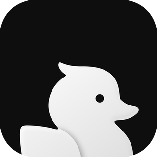
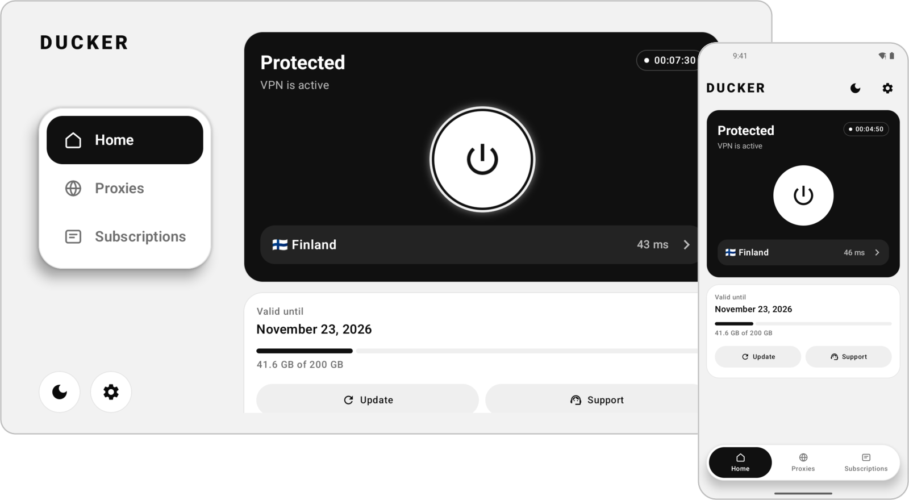
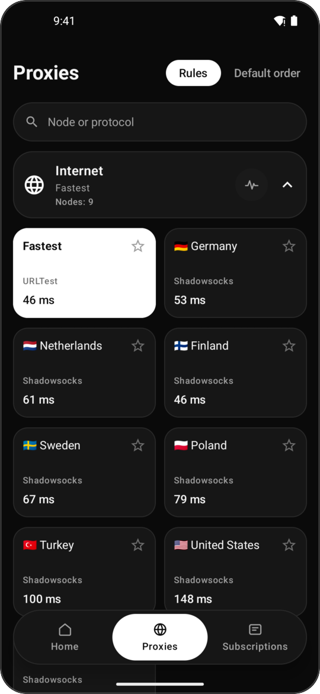
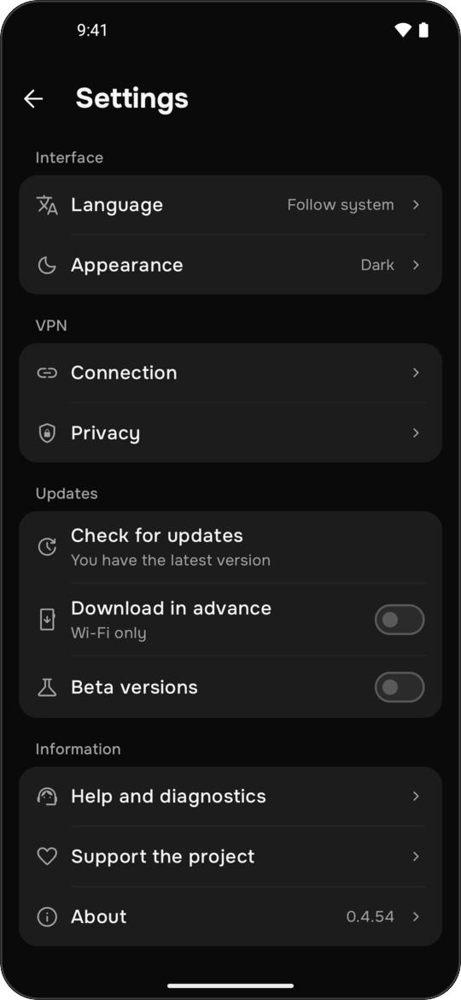
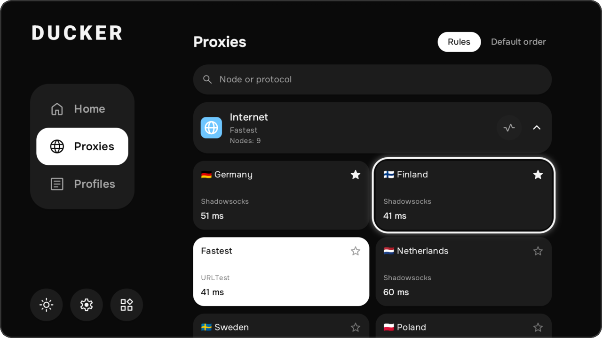
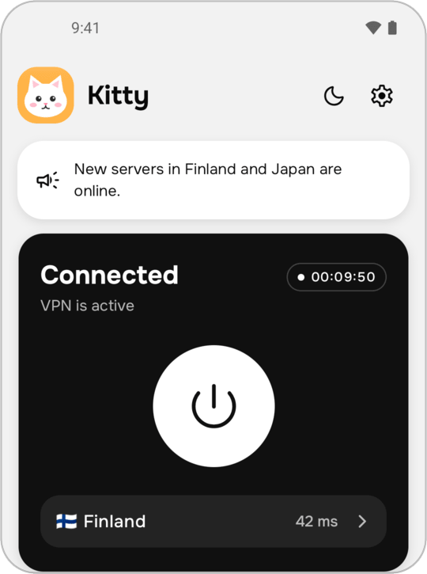

<div align="center">

<picture>
  <source media="(prefers-color-scheme: dark)" srcset="images/duck-dark.png">
  
</picture>

<br>

<picture>
  <source media="(prefers-color-scheme: dark)" srcset="images/wordmark-dark.svg">
  
</picture>

<br>

**适用于 Android 和 Android TV 的开源 mihomo 客户端。**<br>
一个按钮，如实的状态，屏幕上没有多余的东西。

[English](../README.md) · [Русский](README.ru.md) · **简体中文** · [فارسی](README.fa.md)

[](https://github.com/duckerapp/ducker/releases)
[](../LICENSE)
[](#安装)
[](https://t.me/ducker_mihomo)

[安装](#安装) · [功能](#功能) · [截图](#截图) · [Android TV](#android-tv) · [给服务商](#给服务商) · [常见问题](FAQ.md) · [社区](#社区)

<br>

<picture>
  <source media="(prefers-color-scheme: dark)" srcset="images/en/hero-dark.png">
  
</picture>

</div>

> 本译文由 AI 助手翻译，应用界面目前只有英文和俄文。欢迎母语使用者在
> [Issues](https://github.com/duckerapp/ducker/issues) 中指正。

## 这是什么

ducker 通过 [mihomo](https://github.com/MetaCubeX/mihomo) 内核把手机或电视连接到 VPN。
添加服务商提供的订阅，按下一个按钮，需要时再选择服务器即可。

它是 [Clash Meta for Android](https://github.com/MetaCubeX/ClashMetaForAndroid) 的分支：VPN
服务和内核绑定来自上游，界面用 Jetpack Compose 重新编写。免费，无广告，无统计，采用 GPL-3.0
许可证。

## 功能

**日常使用**

- **一个屏幕只做一件事。** 主页显示电源按钮、当前节点及其延迟、订阅到期时间和剩余流量。其余内容
  滑动一下就能看到。
- **如实的状态。** 隧道建立后，ducker 会立即检查流量是否真的经过节点。如果没有，会出现一张卡片
  说明情况，并建议切换到最快的节点。
- **看得懂的错误提示。** VPN 停止或订阅更新失败时，你看到的是原因和解决办法，而不是错误代码。
- **多种方式添加订阅。** 链接、二维码或文件均可。完整的 mihomo 配置按原样使用；由 `vless://`、
  `vmess://`、`ss://`、`trojan://` 等链接组成的普通列表会放入内置配置，其分流规则面向俄罗斯：
  被封锁的网站走节点，俄罗斯本地网站直连。
- **节点。** 配置中的分组、延迟检测、收藏、搜索、按延迟排序，以及显示丢包率和最小、平均、最大
  延迟的节点测试。
- **浅色与深色。** 两种主题都是黑白风格；切换主题时会有波纹在屏幕上扩散。

**需要更多时**

- **应用。** 选择哪些应用走 VPN，哪些绕过。
- **我的规则。** 让某个网站、应用、地址、分类或整个国家走 VPN、绕过 VPN 或直接拦截——无需编辑
  YAML。
- **配置编辑器。** 直接在设备上编辑配置；应用前由内核校验。配置按原样使用：ducker 不会悄悄改写
  配置项。
- **快捷入口。** 桌面小组件、快捷设置磁贴、启动器快捷方式，以及可选的
  [由 Tasker 等应用控制](#由其他应用控制)。
- **保持运行。** 重启或应用更新后自动启动，并针对小米、三星、华为、OPPO、vivo 和传音等喜欢
  杀后台的手机提供分步指引。
- **隐私选项。** 可将 ducker 从最近任务中隐藏，或把图标伪装成计算器。
- **语言。** 英文和俄文；计划支持简体中文和波斯文。

**技术细节**

- **mihomo v1.19.32**，从源码构建，带有最新的 uTLS 指纹。
- **社区对内核的补丁：** 与 Xray 兼容的多路复用（支持 UDP 和 XUDP 的 mux.cool）、与 Xray 同步的
  REALITY（ML-KEM、ML-DSA-65，并对旧服务器回退），以及遇到损坏的节点时跳过它而不是让整个
  provider 失败。作者和来源见 [CREDITS.md](CREDITS.md)。
- **内置 [zashboard](https://github.com/Zephyruso/zashboard)** 面板用于诊断。它随应用打包，由内核
  在本机提供，运行时不会从网络下载任何内容。
- **在低价手机上实测。** 在 Redmi Note 9S（2020 年，Android 12）上，VPN 运行时应用冷启动约
  0.4 秒；Android 回收界面进程后，VPN 仍继续工作。

## 截图

<p align="center">
  <a href="images/en/phone-home.png"></a>
  <a href="images/en/phone-proxies.png"></a>
  <a href="images/en/phone-subscriptions.png"></a>
  <a href="images/en/phone-settings.png"></a>
</p>

<p align="center"><sub>Home · Proxies · Subscriptions · Settings。截图中的服务商及其服务器均为虚构。</sub></p>

## Android TV

同一个 APK 可在 Android TV 和 Google TV 上运行。

- **为遥控器设计。** 左侧是导航栏，当前焦点周围有发光边框；主要页面——Home、Proxies、
  Subscriptions——可用方向键操作。
- **不用遥控器输入链接。** 电视显示二维码；在手机上的 ducker 中扫描它（Subscriptions → **+** →
  Scan QR），订阅就会通过家庭网络发送到电视。链接经过加密（AES-256-GCM），一次性密钥只存在于
  这个二维码中，而且电视只在二维码显示期间监听网络。
- **仍在完善。** 电视支持是新功能。从设置打开的部分页面用遥控器操作还不够方便，目前主要在
  模拟器中测试——非常欢迎来自真实电视的反馈。

<p align="center">
  <a href="images/en/tv-proxies.png"></a>
  <a href="images/en/tv-add.png"></a>
</p>

## 安装

1. 从 [Releases](https://github.com/duckerapp/ducker/releases) 下载 APK：
   - `arm64-v8a` —— 2017 年以后的几乎所有手机；
   - `armeabi-v7a` —— 较旧的手机和许多电视；第一个装不上时选它。
2. 打开文件。Android 会要求允许从此来源安装——对 Google Play 之外的应用来说这是正常的。
3. 添加订阅：**Subscriptions → + →** 粘贴服务商给的链接、扫描二维码或选择文件。形如
   `ducker://install-config?url=…` 的链接可以直接从聊天或邮件中打开同一个窗口。
4. 在 **Home** 上按下电源按钮，并允许 Android 的 VPN 请求。

需要 Android 10 或更高版本。每个发布版本都附带 APK 的 `SHA256SUMS` 校验文件。

遇到问题？请看[常见问题](FAQ.md)：如何添加订阅、VPN 自动断开或没有网络时怎么办、如何发送日志。
常见问题为俄文，末尾有简短的英文部分。

## 给服务商

ducker 可使用任何普通的 mihomo 订阅。此外，服务商可以通过订阅请求的响应头让应用带上自己的品牌。
在 [Remnawave](https://github.com/remnawave/panel) 中，它们在订阅响应设置
（`customResponseHeaders`）里配置，无需修改面板代码。

<p align="center">
  <picture>
    <source media="(prefers-color-scheme: dark)" srcset="images/en/brand-dark.png">
    
  </picture>
</p>

- **`ducker-brand-name: <文本>`** —— 主页顶部显示服务商名称，取代 DUCKER 字样。通知和快捷设置
  磁贴中也会显示。
- **`ducker-brand-logo: <图片>`** —— 主页名称旁和订阅卡片上的标志。可以是 `https://…` 链接，也可以
  是 `data:…;base64,…` 形式的图片本身；支持 PNG、JPEG、WebP 和 SVG。加载失败时显示 ducker 图标。
- **`ducker-buy-url: <链接>`** —— 当剩余不足三天、剩余流量不足 10 % 或已到期时，订阅卡片上出现
  **Renew** 按钮。到期提醒通知也使用这个链接。没有此响应头时使用 `profile-web-page-url`。
- **`ducker-global: off`** —— 隐藏 Proxies 页面上的 Global/Rules 开关；模式保持配置中的设定。
- **`ducker-local-proxy: off`** —— 隧道启动时关闭配置中的本地端口（`mixed-port`、`port`、
  `socks-port`、`redir-port`、`tproxy-port`）并忽略 `listeners`，手机上的其他应用因此无法在
  `127.0.0.1` 上发现代理。配置本身不会被改写。响应头不能打开端口。
- **`ducker-override-user: on | off`** —— 为服务商通过响应头下发的设置预留。应用会读取它，但目前
  没有任何效果。

通用规则：

- 响应头名称不区分大小写。
- 含非 ASCII 字符或换行的文本以 `base64:<…>`（UTF-8）传递，与 Remnawave 发送 `announce` 的方式
  相同。
- 单个短横线 `-` 表示“未设置”：面板不允许保存空的响应头，用短横线可以取消自己的设置。
- 响应头只能改变上面列出的外观和行为，无法触及任何与安全相关的内容：内核 API 密钥、日志或应用
  更新地址。

ducker 还支持常见的订阅响应头：`profile-title`、`profile-update-interval`、
`profile-web-page-url`、`support-url`、`announce`、`subscription-userinfo`、
`subscription-refill-date`。

**设备数量限制。** 每次请求订阅时，ducker 会在 `x-hwid` 中发送稳定的设备 ID，同时发送
`x-device-os`、`x-ver-os` 和 `x-device-model`，面板可以据此统计设备。用户可以在
**Settings → Device ID** 中看到这个 ID 并将其关闭。设备 ID 只通过 HTTPS 发送。

**一键导入。** `ducker://install-config?url=<订阅链接>` 会打开已填好链接的添加订阅窗口；用户确认
之前不会下载任何内容。

## 隐私与安全

- **不收集任何数据。** 没有统计，没有广告，也不会向开发者发送崩溃报告。项目没有自己的服务器。
- **会发往网络的内容：** 向服务商发出的订阅请求、订阅中引用的图片，以及经由服务商服务器的流量。
  完整列表见[隐私政策](../PRIVACY_POLICY.md)。
- **内核 API** 只监听 `127.0.0.1`，并由安装时生成的随机密钥保护。
- **日志留在设备上，** 除非你自己导出。导出前会先移除节点地址、密钥和设备 ID。
- **只信任系统证书。** 手动安装到手机上的证书无法替换服务商的图片或更新应答。
- **由其他应用控制默认关闭，** 需要你自己打开。

发现漏洞？请私下报告：[SECURITY.md](../SECURITY.md)。

## 项目是如何开发的

ducker 由一个人和 AI 助手共同开发。代码由 Anthropic 的 AI 模型 Claude 编写；做什么由项目所有者
决定。每项改动在发布前都会经过构建、测试，并在真实设备上检查；任何人都可以用本仓库重复构建。

加密和协议不是我们写的：它们来自 mihomo 内核。我们对内核的改动是在 v1.19.32 之上的 21 个提交，
其中 13 个是社区为 Xray 兼容的多路复用和 REALITY 编写的补丁。它们公开在
[duckerapp/mihomo](https://github.com/duckerapp/mihomo) 分支仓库的 `ducker` 分支中。

## 由其他应用控制

适用于 Tasker、快捷方式等工具。请先打开 **Settings → Control from other apps**：它默认关闭，
已安装的应用更新后也是如此。该权限对所有能够发送这些命令的应用生效。ducker 自己的小组件、磁贴
和快捷方式不需要它。

| 操作 | Intent |
|---|---|
| 开启 | `am start -a app.ducker.android.action.START_CLASH` |
| 关闭 | `am start -a app.ducker.android.action.STOP_CLASH` |
| 切换 | `am start -a app.ducker.android.action.TOGGLE_CLASH` |
| 添加订阅 | `ducker://install-config?url=<链接>` |

## 后续计划

- Android TV：让其余页面适配遥控器，并增加带二维码的首次启动页面。
- 简体中文和波斯文，包括从右到左的布局。
- 应用内的新版本通知。
- Linux 和 Windows 客户端计划作为独立项目开发，暂无时间表。

各版本已完成的内容见[更新日志](../CHANGELOG.md)（英文）。

## 构建

需要 JDK 21、Android SDK（platform 37、NDK 29.0.14206865）、Go 1.26 或更高版本，以及 git。

```
git clone --recurse-submodules https://github.com/duckerapp/ducker.git
cd ducker
./gradlew :app:assembleMetaRelease
```

不加 `--recurse-submodules` 无法构建：内核是子模块。产物使用调试密钥签名；自己的密钥在仓库根目录
的 `signing.properties` 中设置（`keystore.path`、`keystore.password`、`key.alias`、
`key.password`）。`./scripts/smoke.sh` 会在已连接的手机上检查构建结果。

详情见 [CONTRIBUTING.md](../CONTRIBUTING.md)（俄文，附英文摘要）。

## 致谢

- [MetaCubeX/mihomo](https://github.com/MetaCubeX/mihomo) —— 内核；
- [MetaCubeX/ClashMetaForAndroid](https://github.com/MetaCubeX/ClashMetaForAndroid) —— VPN 服务、
  构建以及界面之下的一切；
- [Zephyruso/zashboard](https://github.com/Zephyruso/zashboard) —— 内置的 Web 面板；
- 内核社区补丁的作者，以及我们借鉴过的想法的作者——全部列在 [CREDITS.md](CREDITS.md) 中。

## 社区

- [Telegram 频道](https://t.me/ducker_mihomo) —— 版本发布和新闻；
- [Telegram 群组](https://t.me/ducker_community) —— 提问和讨论；
- [Issues](https://github.com/duckerapp/ducker/issues) —— 错误报告和建议；
- [CONTRIBUTING.md](../CONTRIBUTING.md) —— 如何报告错误、构建应用和提交改动。

项目由一个人维护，所以每一份帮助都很重要：错误报告、在你的手机或电视上测试，以及翻译——尤其
欢迎中文和波斯文母语使用者。

## 许可证

[GPL-3.0](../LICENSE)，与上游项目相同。
