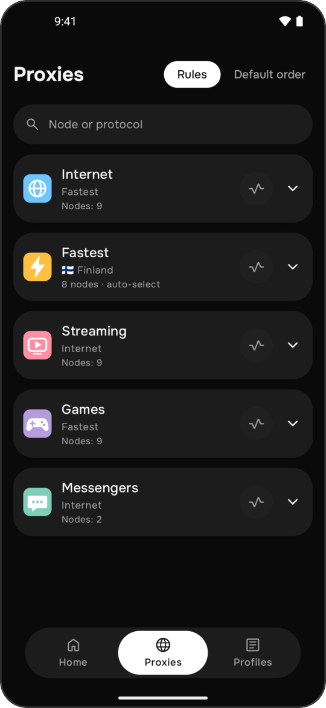
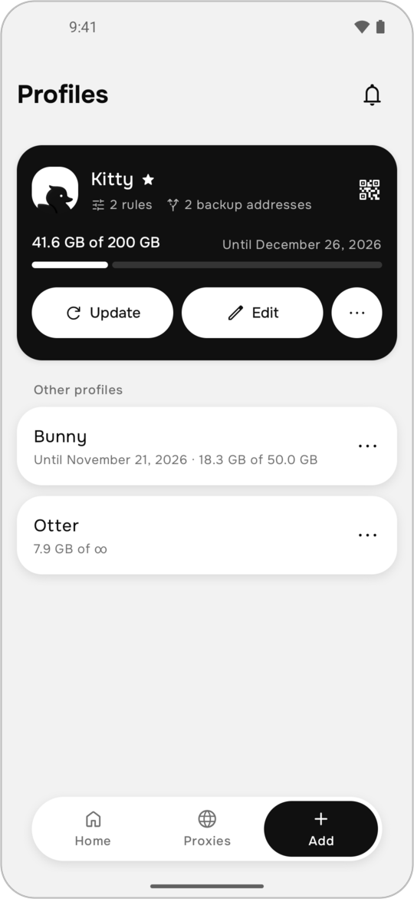
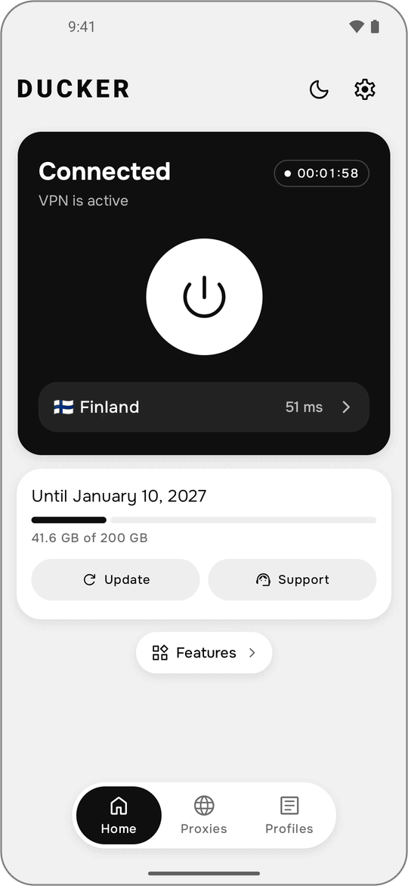
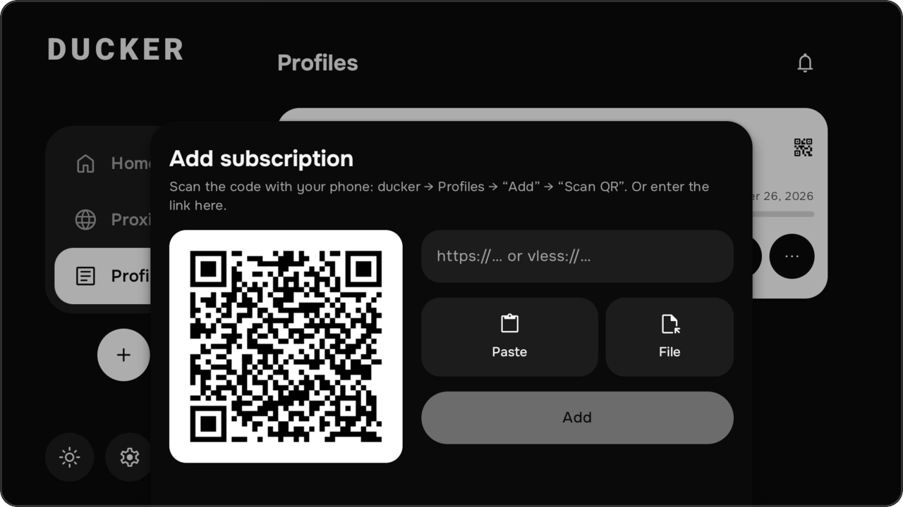

<div align="center">

<picture>
  <source media="(prefers-color-scheme: dark)" srcset="images/duck-dark.png">
  
</picture>

<br>

<picture>
  <source media="(prefers-color-scheme: dark)" srcset="images/wordmark-dark.svg">
  
</picture>

<br>

**适用于 Android 和 Android TV 的开源 VPN 客户端，基于 mihomo 内核。**<br>
一个按钮，如实的状态，屏幕上没有多余的东西。

[English](../README.md) · [Русский](README.ru.md) · **简体中文** · [فارسی](README.fa.md)

[](https://github.com/duckerapp/ducker/releases)
[](../LICENSE)
[](#安装)
[](https://t.me/ducker_news)

[安装](#安装) · [截图](#截图) · [功能](#功能) · [Android TV](#android-tv) · [给服务商](#给服务商) · [后续计划](#后续计划) · [常见问题](FAQ.md) · [社区](#社区)


Android 8+ · 需要自备订阅 · [下载 APK](https://github.com/duckerapp/ducker/releases) · [GitLab 镜像](https://gitlab.com/duckerx/ducker/-/packages) · [网站（英文）](https://duckerapp.github.io/ducker/)

<br>

<picture>
  <source media="(prefers-color-scheme: dark)" srcset="images/en/hero-dark.png">
  
</picture>

</div>

> 本页和应用的中文界面均由 AI 助手翻译。欢迎母语使用者在
> [Issues](https://github.com/duckerapp/ducker/issues) 中指正。截图为英文界面。

## 这是什么

ducker 是基于 mihomo 的 Android VPN 客户端，需要添加服务商提供的订阅。项目源自 [Clash Meta for Android](https://github.com/MetaCubeX/ClashMetaForAndroid)，拥有自己的 Compose 界面、订阅处理和应用更新流程；VPN 服务与构建的基础来自 CMFA。

## 截图

<p align="center">
  <a href="images/en/phone-home.png"></a>
  <a href="images/en/phone-groups.png"></a>
  <a href="images/en/phone-subscriptions.png"></a>
</p>
<p align="center">
  <a href="images/en/phone-proxies.png"></a>
  <a href="images/en/phone-features.png"></a>
  <a href="images/en/phone-settings.png"></a>
</p>

<p align="center"><sub>首页 · 分组 · 订阅 · 节点 · 更多功能 · 设置。截图中的订阅和服务器均为虚构。</sub></p>

<p align="center">
  
</p>

<p align="center"><sub>切换浅色与深色主题时，波纹会在屏幕上扩散。</sub></p>

## 功能

**日常使用**

- **一个屏幕只做一件事。** 主页显示电源按钮、当前节点及其延迟、订阅到期时间和剩余流量。其余内容
  滑动一下就能看到。
- **如实的状态。** 隧道建立后，ducker 会立即检查流量是否真的经过节点。如果没有，会出现一张卡片
  说明情况，并建议切换到最快的节点。
- **看得懂的错误提示。** VPN 停止或订阅更新失败时，你看到的是原因和解决办法，而不是错误代码——
  包括手机系统在后台关闭了 ducker 的情况。
- **多种方式添加订阅。** 链接、二维码或文件均可。完整的 mihomo 配置按原样使用；由 `vless://`、
  `vmess://`、`ss://`、`trojan://` 等链接组成的普通列表会放入内置配置，其分流规则面向俄罗斯：
  被封锁的网站走节点，俄罗斯本地网站直连。加密的订阅用服务商提供的密钥打开。
- **节点。** 配置中的分组及其图标、延迟检测、收藏、搜索、按延迟排序，以及显示丢包率和最小、
  平均、最大延迟的节点测试。
- **自动更新。** 新版本在主页上点一下即可安装，也可以让它在夜里自己安装。见[更新](#更新)。
- **浅色与深色。** 两种主题都是黑白风格；切换主题时会有波纹在屏幕上扩散。

**更多功能**——主页订阅卡片下方的页面：

- **移动网络。** 手机离开 Wi-Fi 时使用单独的订阅和服务器；回到 Wi-Fi 后一切照旧。
- **连接。** 实时查看哪些应用连接到哪里：应用、网站、规则、节点、速度。
- **Wi-Fi 共享。** 通过局域网中的代理，把 VPN 的网络分享给笔记本或另一部手机。

后续版本还会在这里加入新功能。

**需要更多时**

- **应用。** 选择哪些应用走 VPN，哪些绕过。
- **我的规则。** 让某个网站、应用、地址、分类或整个国家走 VPN、绕过 VPN 或直接拦截——无需编辑
  YAML。
- **配置编辑器。** 直接在设备上编辑配置；应用前由内核校验。配置按原样使用：ducker 不会悄悄改写
  配置项。
- **快捷入口。** 桌面小组件、快捷设置磁贴、启动器快捷方式，以及可选的
  [由 Tasker 等应用控制](#由其他应用控制)。
- **保持运行。** 重启或应用更新后自动启动，并针对小米、三星、华为、OPPO、vivo 和传音等喜欢
  杀后台的手机提供分步指引。
- **隐私选项。** 可将 ducker 从最近任务中隐藏、把图标伪装成计算器，或用指纹、PIN 码保护订阅
  链接、它的二维码和配置编辑器。
- **服务商消息。** 服务商的公告显示在主页上；最近十天的公告在“订阅”页的铃铛图标下。
- **语言。** 英文、俄文、简体中文、波斯文、阿拉伯文、西班牙文、法文、印尼文、葡萄牙文（巴西）、
  土耳其文和越南文；波斯文和阿拉伯文采用从右到左的布局。

**技术细节**

- **mihomo v1.19.34**，从源码构建，带有最新的 uTLS 指纹。
- **社区对内核的补丁：** 与 Xray 兼容的多路复用（支持 UDP 和 XUDP 的 mux.cool）、与 Xray 同步的
  REALITY（ML-KEM、ML-DSA-65，并对旧服务器回退），以及遇到损坏的节点时跳过它而不是让整个
  provider 失败。作者和来源见 [CREDITS.md](CREDITS.md)。
- **内置 [zashboard](https://github.com/Zephyruso/zashboard)** 面板用于诊断。它随应用打包，由内核
  在本机提供，运行时不会从网络下载任何内容。
- **在低价手机上实测。** 在 Redmi Note 9S（2020 年，Android 12）上，VPN 运行时应用冷启动约
  0.4 秒；Android 回收界面进程后，VPN 仍继续工作。

**每个订阅可选择配置。** 在订阅的「⋯」菜单中打开配置选项，可保留服务商配置，或选择 `ducker · Russia`：使用订阅中的服务器和 ducker 的规则，俄罗斯网站和应用直连，其余流量经过 VPN。切换会替换手动修改；加密订阅不支持此模板模式。切换失败时保留原来的可用配置。[详细说明（英文）](FAQ.md#configuration-templates)。

## Android TV

**从 iPhone 或未安装 ducker 的手机发送：**用普通相机扫描电视上的二维码，在浏览器打开页面，粘贴订阅链接并点击发送。发送设备不需要安装应用。请使用自己的家庭 Wi-Fi，并保持电视上的二维码页面打开。电脑也可以打开从二维码识别出的链接。[分步说明（英文）](https://duckerapp.github.io/ducker/users/tv/#browser-transfer)。

同一个 APK 可在 Android TV 和 Google TV 上运行。

- **为遥控器设计。** 左侧是导航栏，当前焦点周围有发光边框；各个页面都可用方向键操作——包括配置
  编辑器和日志。
- **不用遥控器输入链接。** 电视显示二维码；在手机上的 ducker 中扫描它（订阅 → 添加 → 扫码），
  订阅就会通过家庭网络发送到电视。链接经过加密（AES-256-GCM），一次性密钥只存在于这个二维码中，
  而且电视只在二维码显示期间监听网络。
- **已在真实电视上检验。** 欢迎反馈其他型号电视上的使用情况。

<p align="center">
  <a href="images/en/tv-proxies.png"></a>
  <a href="images/en/tv-add.png"></a>
</p>

## 安装

1. 从 [Releases](https://github.com/duckerapp/ducker/releases) 下载 APK：
   - `arm64-v8a` —— 2017 年以后的几乎所有手机；
   - `armeabi-v7a` —— 较旧的手机和许多电视；第一个装不上时选它。
2. 打开文件。Android 会要求允许从此来源安装——对 Google Play 之外的应用来说这是正常的。
3. 添加订阅：**订阅 → 添加 →** 粘贴服务商给的链接、扫描二维码或选择文件。形如
   `ducker://install-config?url=…` 的链接可以直接从聊天或邮件中打开同一个窗口。
4. 在**首页**按下电源按钮，并允许 Android 的 VPN 请求。

需要 Android 8 或更高版本。遇到问题？请看[常见问题](FAQ.md)（英文）：如何添加订阅、VPN 自动断开
或没有网络时怎么办、如何发送日志。

### 更新

ducker 只需手动安装一次，之后会自己更新。

- **自动检查**：每天两次，以及每次打开时。新版本会连同更新内容显示在主页和通知中；点一下即可
  下载安装，VPN 会自动重新连接。
- **“自动更新”**（设置）：新版本通过 Wi-Fi 下载，在屏幕关闭时安装，通常在夜里。你同意之前一直
  关闭。需要 Android 12 或更高版本；在 Android 8–11 上，系统每次都会要求确认。
- **“测试版 (Beta)”**（设置）：比其他人早几天获得新版本。表现良好的测试版之后会以同一个文件
  推送给所有人。
- **来源。** 版本列表来自 GitHub；GitHub 无响应时改用 [GitLab 镜像](https://gitlab.com/duckerx/ducker)
  或 jsDelivr。安装前 ducker 会核对文件的校验和，并确认它与已安装的应用使用同一密钥签名：其他人
  的文件不会被安装。

Android 可能推迟后台检查；即使在 Android 12+ 上，Play Protect 或设备策略也可能要求确认安装。关闭 beta 不会降级已安装的版本；转为稳定版时仍使用同一个 APK。

### 检查文件

- 每个发布版本都附带 `SHA256SUMS`，即其中 APK 的校验和。
- 每个发布版本的说明中都有每个 APK 的 [VirusTotal](https://www.virustotal.com) 报告链接：数十款
  杀毒引擎检查过的正是这个文件。你也可以自己上传手上的文件进行对比。
- 应用由本仓库构建；构建时还会下载 zashboard 面板的发布版本（按 SHA-256 校验）以及 MetaCubeX/meta-rules-dat 的
  国家和网站数据库。自己构建的方法见[构建](#构建)。

VirusTotal 报告仅反映所示时间对该文件的扫描结果，不能保证安全。

### Google 的开发者验证

截至 2026 年 11 月，ducker 尚未参加 Google 开发者验证。首阶段限制只涉及部分国家的手机和平板电脑上的指定应用商店，暂不包括直接下载 APK。Google 计划从 2027 年起扩大实施范围；实际要求取决于国家、设备和安装渠道。若系统提示允许未验证开发者的应用，请参阅[常见问题（英文）](FAQ.md#android-asks-to-allow-apps-from-unverified-developers)。通过 `adb` 安装不受影响。[Google 官方说明](https://developer.android.com/developer-verification/guides/faq)。

## 给服务商

ducker 可使用任何普通的 mihomo 订阅。它请求订阅时使用的 User-Agent 是
`mihomo/<内核版本> ducker/<应用版本> (android)`，因此会向 mihomo 客户端提供配置的面板，也会向
ducker 提供：

| 面板 | ducker 能否获得 mihomo 配置 | 名称、流量、期限 | 公告 | 设备数量限制 | ducker 专用响应头 |
|---|---|---|---|---|---|
| Remnawave | 默认即可 | 是 | 是 | 是 | 自定义响应头 |
| PasarGuard | 默认即可 | 是 | 是 | 是 | 自定义响应头 |
| Marzban | 默认即可 | 是 | — | — | — |
| Marzneshin | 在最后一条规则之上添加规则 `^mihomo` → `clash-meta`，或给用户 `…/clash-meta` 链接 | 是 | — | — | — |
| 3x-ui | 打开 Clash 订阅及其自动识别，或给用户 `/mihomo/<subid>` 链接 | 是 | 是 | 是 | — |
| Hiddify | 给用户 `…/clashmeta/` 链接 | 是 | — | — | — |

<sub>2026 年 11 月对照面板代码核实：Remnawave 3.4.8、PasarGuard 5.6.0、Marzban 0.8.4、Hiddify 14.2.0。Hiddify 将不限量套餐显示为很远的日期。</sub>

如果面板只返回普通的链接列表，ducker 仍能连接：它会把节点放入内置配置。

此外，服务商可以通过订阅请求的响应头让应用带上自己的品牌。在
[Remnawave](https://github.com/remnawave/panel) 中，它们在订阅响应设置
（`customResponseHeaders`）里配置，无需修改面板代码。

<p align="center">
  <picture>
    <source media="(prefers-color-scheme: dark)" srcset="images/en/brand-dark.png">
    
  </picture>
</p>

服务商文档（英文）：[响应头](https://duckerapp.github.io/ducker/providers/headers/)、[镜像和加密订阅](https://duckerapp.github.io/ducker/providers/start/)。

## 隐私与安全

- **不收集任何数据。** 没有统计，没有广告，也不会向开发者发送崩溃报告。项目没有自己的服务器。
- **会发往网络的内容：** 向服务商发出的订阅请求、订阅中引用的图片、ducker 新版本检查，以及经由
  服务商服务器的流量。完整列表见[隐私政策](../PRIVACY_POLICY.md)。
- **内核 API** 只监听 `127.0.0.1`，并由安装时生成的随机密钥保护。
- **日志留在设备上，** 除非你自己导出。导出前会先移除节点地址、密钥和设备 ID。
- **只信任系统证书。** 手动安装到手机上的证书无法替换服务商的图片或更新应答。
- **由其他应用控制默认关闭，** 需要你自己打开。

发现漏洞？请私下报告：[SECURITY.md](../SECURITY.md)。

## 项目是如何开发的

ducker 由一位维护者与 AI 助手共同开发。我们通过自动测试、模拟器和真实设备检查应用。源代码开放，你可以了解应用的工作方式并自行构建。加密与协议来自 mihomo；精确版本由子模块固定。核心改动位于 [mihomo](https://github.com/duckerapp/mihomo)、[uTLS](https://github.com/duckerapp/utls) 和 [sing-mux](https://github.com/duckerapp/sing-mux) 分支中。

## 由其他应用控制

适用于 Tasker、快捷方式等工具。请先打开 **设置 → 隐私 → 允许其他应用控制**：它默认关闭，
已安装的应用更新后也是如此。该权限对所有能够发送这些命令的应用生效。ducker 自己的小组件、磁贴
和快捷方式不需要它。

| 操作 | Intent |
|---|---|
| 开启 | `am start -a app.ducker.android.action.START_CLASH` |
| 关闭 | `am start -a app.ducker.android.action.STOP_CLASH` |
| 切换 | `am start -a app.ducker.android.action.TOGGLE_CLASH` |
| 添加订阅 | `ducker://install-config?url=<链接>` |

## 后续计划

- **桌面客户端**，支持 Windows、Linux 和 macOS。
- **“仅通过 VPN”：** VPN 关闭时，选定的应用完全无法联网。

暂无时间表。目前暂不计划推出 iOS 版本。

各版本已完成的内容见[更新日志](../CHANGELOG.md)（英文）。

## 构建

需要 JDK 21、Android SDK（platform 37、NDK 29.0.14206865）、git、curl 和 patch；Go 由构建过程自行下载。

```
git clone --recurse-submodules https://github.com/duckerapp/ducker.git
cd ducker
./gradlew :app:assembleMetaRelease
```

不加 `--recurse-submodules` 无法构建：内核是子模块。产物使用调试密钥签名；自己的密钥在仓库根目录
的 `signing.properties` 中设置（`keystore.path`、`keystore.password`、`key.alias`、
`key.password`）。`./scripts/smoke.sh` 会在已连接的手机上检查构建结果。

详情见 [CONTRIBUTING.md](../CONTRIBUTING.md)（英文）；代码结构见
[代码地图](ARCHITECTURE.md)（英文）。

## 致谢

- [MetaCubeX/mihomo](https://github.com/MetaCubeX/mihomo) —— 内核；
- [MetaCubeX/ClashMetaForAndroid](https://github.com/MetaCubeX/ClashMetaForAndroid) —— ducker 起步时所用的 VPN
  服务和构建基础；
- [Zephyruso/zashboard](https://github.com/Zephyruso/zashboard) —— 内置的 Web 面板；
- 内核社区补丁的作者，以及我们借鉴过的想法的作者——全部列在 [CREDITS.md](CREDITS.md) 中。

## 社区

- [Telegram 频道](https://t.me/ducker_news) —— 版本发布和新闻；
- [Telegram 群组](https://t.me/ducker_chat) —— 提问和讨论；
- [Issues](https://github.com/duckerapp/ducker/issues) —— 错误报告和建议；
- [duckermihomo@proton.me](mailto:duckermihomo@proton.me) —— 邮箱，不方便用 Telegram 和 GitHub 时可以写信；
- [CONTRIBUTING.md](../CONTRIBUTING.md) —— 如何报告错误、构建应用和提交改动。

项目由一个人维护，所以每一份帮助都很重要：错误报告、在你的手机或电视上测试，以及翻译——尤其
欢迎上述各语言的母语使用者。

用钱支持项目：通过 Telegram 中的 [CryptoBot](https://t.me/send?start=IVviDBljozrs)（任意币种），或转入钱包——地址见[网站（英文）](https://duckerapp.github.io/ducker/support/donate/)
和应用内「设置 → 支持项目」。

## 许可证

[GPL-3.0](../LICENSE)，与上游项目相同。
