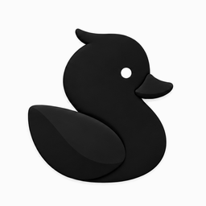
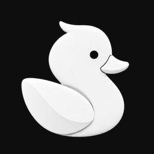

# DUCKER { .ducker-title }

{ .ducker-mark .ducker-mark--light }
{ .ducker-mark .ducker-mark--dark }

Открытый клиент [mihomo](https://github.com/MetaCubeX/mihomo) для Android: подключение
по подписке, выбор узла, честные задержки — и ничего лишнего на экране.

Без рекламы, без аналитики, без отчётов разработчику. Этот сайт тоже ничего никуда не шлёт.

[Установить](users/install.md){ .md-button .md-button--primary }
[Вопросы и ответы](users/faq.md){ .md-button }

-   **Пользователям**

    ---

    Как [установить](users/install.md) и добавить подписку, что делать, если
    [VPN сам отключается](users/faq.md#vpn-сам-отключается), как
    [прислать журнал](users/faq.md#как-прислать-журнал).
    Что приложение отправляет в сеть — [приватность](users/privacy.md).

-   **Провайдерам**

    ---

    Название, логотип, кнопка продления и другие настройки вида —
    [заголовками `ducker-*`](providers/headers.md) в ответе подписки.

-   **Помочь проекту**

    ---

    Проект ведёт один человек. Помогают [сообщения об ошибках](help/contributing.md),
    переводы, проверка на своих телефонах и код. Уязвимости — [отдельно](help/security.md).

-   **Поддержать**

    ---

    [Донаты](support/donate.md), [написать разработчику](support/contact.md) и
    [благодарности](support/credits.md) тем, на чьей работе стоит ducker.

